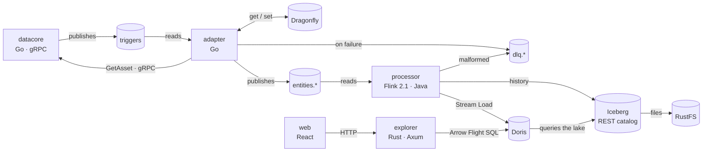

# asset-discovery-lab

A small, local replica of the new data pipeline Lansweeper is building.

- **Ingestion:** change notices from a simulated DataCore are completed by a Go adapter.
- **Processing:** a Flink 2.1 job cleans them and writes them to Doris 4.1 (current state) and to an Iceberg lake on RustFS (history).
- **Serving:** a Rust API reads Doris over Arrow Flight SQL and feeds a React web page.

The lab exists to learn that stack hands-on. Correctness under failure matters more than scale or features: duplicates, stale reads, malformed messages and crashes. Everything runs in Docker Compose on one laptop.

The system is specified in [`docs/development/system-spec.md`](docs/development/system-spec.md). Decisions taken while building it are in [`docs/development/decision-log.md`](docs/development/decision-log.md).

## Architecture



### Data flow

1. **datacore → `triggers`.** datacore owns assets, users and groups in SQLite. Every change writes an outbox row in the same transaction, and a relay publishes a light `Trigger` (type, id, version, time) to `triggers`.
2. **adapter → `entities.*`.** The adapter (consumer group `adl-adapter`) completes each trigger:
   - it looks in Dragonfly first, then calls `DataCoreService.Get*` over gRPC;
   - it publishes the full entity to `entities.assets`, `entities.users` or `entities.groups`, and only then commits the trigger offset;
   - permanent failures go to `dlq.adapter`.
3. **processor → Doris.** The Flink job `adl-processor`:
   - drops stale and duplicate versions with a keyed `VersionGate`;
   - routes malformed records to `dlq.processor`;
   - writes current state to Doris with two-phase-commit Stream Load;
   - counts changes per minute into `change_rate_1m`.
4. **processor → lake.** The same job appends every accepted asset version to the Iceberg table `inventory.asset_changes`: Parquet files on RustFS, committed through the REST catalog on each checkpoint.
5. **Doris → lake.** Doris reads the lake through its Iceberg catalog `lake`.
6. **explorer → Doris.** The explorer queries Doris over Arrow Flight SQL: handshake and `GetFlightInfo` with the FE, then `DoGet` against the BE. It is the only way into the data.
7. **web → explorer.** The web calls `/api/*`, which nginx proxies to the explorer.

### Repository layout

| Path | What |
|---|---|
| `proto/adl/v1/`, `gen/go/` | Protobuf contracts and generated Go code (`make generate`) |
| `datacore/`, `adapter/` | Go services |
| `adlctl/`, `labkit/` | The lab CLI, and the Go clients and reconciliation it shares with the tests |
| `acceptance/` | The black-box acceptance suite (38 cases, build tag `acceptance`) |
| `processor/` | The Flink job (Java 17, Maven); `src/generated/java` holds the generated Java code |
| `explorer/` | The Rust API (Axum, `arrow-flight`) |
| `web/` | The React app (Vite, TypeScript), served by nginx |
| `infra/` | The Doris and Flink images and init SQL, plus helper scripts |
| `docs/development/` | The specification, the build plan, the decision log and the sprint reports |

## Quick start

### Prerequisites (spec §15.1)

- macOS on Intel or Linux x86_64.
- Docker Desktop with **at least 12 GB of memory**, 4 CPUs and a 64 GB disk, and Docker Compose v2.24 or later.
- Go 1.26, GNU make and git.

Nothing else: Java, Rust and Node run inside containers.

### Start, verify, stop

```sh
make build        # build every image (the first build takes a while)
make up           # start the full stack and wait until it is ready (about 2 minutes once built)
make acceptance   # run the whole acceptance suite, gates A to E (about 35 minutes)
make reconcile    # compare Doris and the lake with datacore
make down         # stop, with a Flink savepoint; state is kept
make clean        # remove every container and volume: the next make up starts from scratch
```

`make up` creates `.env` from `.env.example` on first use, and runs `make host-prep` (see Troubleshooting).

Once it is ready:
- the web: <http://localhost:3000>;
- the Flink UI: <http://localhost:8081>;
- the explorer API: <http://localhost:8080/api/assets/LT-0042>.

**Core-only mode.** `make up-core` starts only Kafka, Dragonfly, datacore, the adapter, Doris and Flink, without the lake and the app. Switching between `make up-core` and `make up` needs `make clean` in between: a running job keeps the mode it was submitted with.

## Make targets

| Target | Does |
|---|---|
| `help` (default) | Lists the targets |
| `env` | Creates `.env` from `.env.example` if it does not exist |
| `host-prep` | Sets `vm.max_map_count=2000000` in the Docker VM (needed by the Doris BE) |
| `generate` | `buf generate`: Go and Java code from the contracts |
| `build` | Builds every image |
| `up` | `env` + `host-prep` + start profiles `core`, `lake` and `app` + `adlctl wait --timeout 15m` |
| `up-core` | The same, with profile `core` only and `ICEBERG_ENABLED=false` |
| `down` | `adlctl flink stop-with-savepoint`, then `docker compose stop`. Keeps the volumes |
| `clean` | `docker compose down --volumes --remove-orphans`. Removes all state |
| `ps`, `logs` | Status, and the last 200 log lines (`SERVICE=name` to filter) |
| `test` | Unit tests: Go on the host; Maven, Cargo and npm in builder containers |
| `lint` | buf lint and breaking, golangci-lint, Spotless (google-java-format), rustfmt and clippy, ESLint, Prettier and `tsc` |
| `acceptance` | Every acceptance gate, A to E, against the running stack |
| `acceptance-gate GATE=X` | One gate (`A`, `B`, `C`, `D` or `E`) |
| `reconcile` | `adlctl reconcile --timeout 3m` |
| `chaos-on`, `chaos-off` | Turns datacore chaos on (spec §7.9 values) or off |
| `burst N=…` | Applies N generator changes at once |
| `move ID=… SITE=…` | Moves an asset to another site |

`adlctl` (`go run ./adlctl`) has more commands: `generator pause|resume|rate N`, `chaos show`, `stats` and `wait`. Run it without arguments to list them.

## Services and ports

| Service | Profile | Host port | What |
|---|---|---|---|
| `kafka` | core | 29092 | Kafka 4.3 in KRaft mode (`kafka:9092` inside the network) |
| `kafka-init` | core | — | One-shot: creates the six topics |
| `dragonfly` | core | 6379 | Entity cache |
| `datacore` | core | 50051 (gRPC), 8090 (HTTP) | Simulated DataCore with the generator, chaos and the admin API |
| `adapter` | core | 8091 | Trigger-to-entity adapter |
| `doris-fe` | core | 8030 (HTTP), 9030 (MySQL) | Doris frontend, `172.30.0.2`; Flight SQL on 8070, internal |
| `doris-be` | core | — | Doris backend, `172.30.0.3`; HTTP 8040 and Flight SQL 8050, internal |
| `doris-init` | core | — | One-shot: database, tables, view, MV, user `explorer` |
| `flink-jobmanager` | core | 8081 | Flink UI and REST |
| `flink-taskmanager` | core | — | Two slots |
| `flink-job` | core | — | One-shot: submits `adl-processor`, restoring from the newest savepoint or checkpoint |
| `rustfs` | lake | 9000 (S3), 9001 (console) | Object storage, bucket `warehouse` |
| `rustfs-init` | lake | — | One-shot: creates the bucket |
| `iceberg-rest` | lake | 8181 | Iceberg REST catalog |
| `doris-init-lake` | lake | — | One-shot: Doris catalog `lake` and its grant |
| `explorer` | app | 8080 | HTTP JSON API |
| `web` | app | 3000 | React app; `/api/` is proxied to the explorer |

The lab's credentials and defaults are in `.env.example`: S3 keys, the Doris `explorer` password and `ICEBERG_ENABLED`. Doris `root` has an empty password.

## Walkthrough: LT-0042 moves to Madrid

This follows spec §4.3 step by step. The generator also changes LT-0042 from time to time, so pause it first and read where the asset is now. Do not assume the seed values.

```sh
go run ./adlctl generator pause
curl -s localhost:8080/api/assets/LT-0042        # current site, owner, group and version n
```

### 1. datacore commits the change and publishes the trigger

```sh
make move ID=LT-0042 SITE=Madrid                 # prints: site X -> Madrid, version n -> n+1
```

If LT-0042 is already in Madrid, move it somewhere else first; any upsert creates a new version anyway. Then read the trigger on `triggers`, with key `asset:LT-0042`:

```sh
docker compose exec kafka /opt/kafka/bin/kafka-console-consumer.sh \
  --bootstrap-server localhost:9092 --topic triggers --from-beginning --timeout-ms 15000 \
  --property print.key=true --property print.partition=true --property print.offset=true \
  --property print.value=false | grep 'asset:LT-0042' | tail -1
```

### 2–5. The adapter completes it

The adapter consumes the trigger, misses Dragonfly, calls `GetAsset`, caches the entity and publishes it to `entities.assets`.

- **Per-record logs.** These are at debug level. Start the stack with `ADAPTER_LOG_LEVEL=debug make up`, or recreate only the adapter:
  ```sh
  ADAPTER_LOG_LEVEL=debug docker compose --profile core --profile lake --profile app up -d adapter
  make logs SERVICE=adapter | grep LT-0042
  ```
  You get a line `"published"` with `partition`, `offset`, `version` and `entity_version`.
- **The cached entity and its TTL** (3600 s):
  ```sh
  docker compose exec dragonfly redis-cli TTL entity:asset:LT-0042:v<n+1>
  ```
- **The record on `entities.assets`.** It has key `LT-0042` and the header `trigger.version`:
  ```sh
  docker compose exec kafka /opt/kafka/bin/kafka-console-consumer.sh \
    --bootstrap-server localhost:9092 --topic entities.assets --from-beginning --timeout-ms 15000 \
    --property print.key=true --property print.headers=true --property print.value=false \
    | grep '^trigger.version.*LT-0042$' | tail -1
  ```
- **Consumer lag:** `go run ./adlctl stats`.

### 6–7. Flink accepts it

Open <http://localhost:8081>, then the job `adl-processor` and its `VersionGate` operator. Its `versionGateAccepted` counter grows by one. The row is committed to Doris with the next checkpoint (every 10 s).

### 8. Doris holds the new state

```sh
docker run --rm --network adl_adl mysql:8.4.13 mysql -h doris-fe -P 9030 -uroot -e "
  SELECT id, site, version, changed_at FROM inventory.assets WHERE id='LT-0042';
  SELECT id, site, owner_name, group_name, version FROM inventory.v_assets_enriched WHERE id='LT-0042';
  SELECT * FROM inventory.mv_assets_by_os_site WHERE site='Madrid';"
```

If the `mysql` client is installed on your machine, `mysql -h 127.0.0.1 -P 9030 -uroot` works too. The materialized view refreshes every minute.

### 9. The lake holds the history

```sh
docker run --rm --network adl_adl mysql:8.4.13 mysql -h doris-fe -P 9030 -uroot -e "
  SELECT version, site, changed_at FROM lake.inventory.asset_changes WHERE id='LT-0042' ORDER BY version;"
```

The Parquet and metadata files are in bucket `warehouse` under `inventory/asset_changes/`. Browse them in the RustFS console at <http://localhost:9001>, with the keys from `.env`.

### 10–14. The web and the explorer serve it

```sh
curl -s localhost:3000/api/assets/LT-0042           # through nginx: site Madrid, version n+1, owner and group
curl -s localhost:3000/api/assets/LT-0042/history   # every version in the lake, ascending
curl -s localhost:8080/readyz                       # {"status":"ready","doris_transport":"flight-sql"}
```

Or open <http://localhost:3000>: the card shows LT-0042 in Madrid, and the History button lists the versions.

When you are done, resume the generator with `go run ./adlctl generator resume`.

## Testing

| Level | Command | What |
|---|---|---|
| Unit | `make test` | In-process logic of every component (spec §16.2). No running stack needed |
| Lint | `make lint` | Formatting and linters for every language, plus `buf breaking` against `main` |
| Acceptance | `make acceptance` | 38 black-box cases against the running stack: gate A ingestion, B processing, C lake, D serving, E failures. Start from `make clean && make up` |
| Reconciliation | `make reconcile` | Pauses the generator, compares every entity in Doris, and every asset's latest version in the lake, with datacore |
| Chaos | `make chaos-on`, wait, `make chaos-off`, `make reconcile` | See below |

**Chaos.** `make chaos-on` makes datacore:
- publish duplicate, malformed and phantom triggers;
- answer `Get*` with stale reads and `UNAVAILABLE` errors.

The pipeline must still converge. After a few minutes, `make chaos-off && make reconcile` must pass. The dead letters are on `dlq.adapter`; `dlq.processor` should stay empty.

**Gate E** also kills the adapter and the Flink TaskManager in the middle of a 1,000-change burst, restarts the stack with `make down && make up`, stops Dragonfly and restarts datacore. Every case ends with a passing reconcile.

CI runs `.github/workflows/ci.yml` on every push: contracts, Go, Java, Rust, web and image builds. `.github/workflows/e2e.yml` builds the images, starts the full stack and runs the acceptance suite on pushes to `main`. It needs a runner with at least 16 GB of RAM.

## Troubleshooting

- **Memory.** The container limits add up to 11,456 MiB (spec §15.4), so Docker needs 12 GB.
  - Check usage with `docker stats`.
  - The Doris FE is the tightest container: its heap is **1024m**, not the spec's 1280m. The larger heap would not fit in its 1792 MiB limit next to the JVM's native memory (decision D-044).
  - If a container is OOM-killed (`docker inspect <container> --format '{{.State.OOMKilled}}'`), see spec §3 R9.
  - Do not run `make build` of the Rust or Java images while the full stack is up.
- **`vm.max_map_count`.** The Doris BE refuses to start unless `vm.max_map_count ≥ 2000000` inside the Docker VM. `make host-prep`, which `make up` runs, sets it with a privileged container. Docker Desktop forgets it on restart, so it runs every time.
- **Slow starts.** JVMs under Docker Desktop on an Intel Mac are slow to start. The Doris health checks allow 3 minutes and `adlctl wait` up to 15. A service counts as failed only after its timeout. `make ps` and `make logs SERVICE=doris-fe` show progress.
- **`docker compose` and profiles.** Every service has a profile. Commands that name an `app` service need all three profiles, or they fail with "no such service: doris-init":
  ```sh
  docker compose --profile core --profile lake --profile app logs explorer
  ```
  `make logs SERVICE=explorer` does it for you.
- **The adapter restarts.** The adapter exits on purpose when it cannot publish or commit outside a shutdown, and compose restarts it. It then handles the records again from the last committed offset. A restart loop points at Kafka.
- **Lake history lags.** Doris sees new lake snapshots 10–20 s after a change: the catalog metadata cache is off. The catalog uses the property `use_path_style`, because Doris 4.1.5 ignores the spec's `s3.use_path_style` (D-037).
- **Arrow Flight SQL.** The explorer uses step 1 of the spec's Flight SQL ladder, `arrow-flight`'s client against the FE and then the BE, with no deviation from the diagram (D-040). `/readyz` reports `doris_transport`.
- **Start over.** `make clean && make up` removes every volume and rebuilds the state from the deterministic seed.

## How this was built

The base was built in one go by an AI agent (Claude Code), unattended, from [`docs/development/system-spec.md`](docs/development/system-spec.md) and the build order in [`docs/development/sprints-plan.md`](docs/development/sprints-plan.md).
- Six sprints, 0 and A to E, each in a fresh session.
- Every sprint planned first, ended with its acceptance gate green, and was reviewed by an independent audit agent. The reports are in `docs/development/sprints/`.
- Every rule applied, fallback taken and version pinned is in [`docs/development/decision-log.md`](docs/development/decision-log.md); open doubts are in [`docs/development/open-questions.md`](docs/development/open-questions.md).

From here on, the lab is extended through tickets.

## Licence

[MIT](LICENSE).
