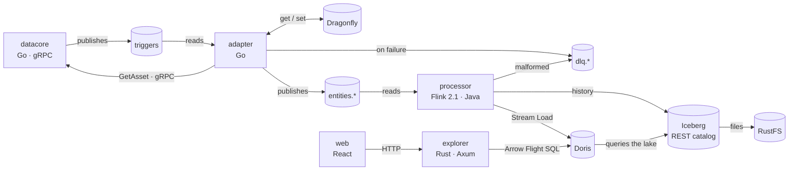

# asset-discovery-lab — System Specification

| | |
|---|---|
| Status | Approved for build |
| Version | 1.0 (2026-11-25) |
| Owner | Cristian |
| Companion documents | `specs/sprints-plan.md` (build order), `specs/decision-log.md` (decisions taken during the build) |

This document is the single source of truth for **what** the base of asset-discovery-lab is. The sprints plan says **in which order** it is built. When the two disagree, this document wins (§3, G5).

Keywords: **MUST** and **MUST NOT** are hard requirements; **SHOULD** means "do this unless a rule in §3 says otherwise"; **MAY** is optional. Section references look like §10.6.

---

## Contents

1. Purpose and scope
2. Pinned versions
3. Known risks and decision rules
4. Architecture and flow
5. Data model
6. Contracts
7. datacore
8. Kafka
9. adapter
10. processor
11. Doris
12. Lake
13. explorer
14. web
15. Local environment
16. Tests
17. Repository and conventions
18. Definition of Done
- Appendix A. One change in every representation

---

## 1. Purpose and scope

### 1.1 Purpose

asset-discovery-lab is a small, local replica of the new data pipeline Lansweeper is building. Change notices from DataCore are completed by a Go adapter, cleaned by a Flink job, and written to Doris (current state) and to an Iceberg lake (history). A Rust API serves them to a web page.

The lab exists to learn that stack hands-on. Correctness under failure (duplicates, stale reads, malformed messages, crashes) matters more than scale or features.

### 1.2 In scope (the base)

- The twelve components of §4.2: datacore, the `triggers` topic, adapter, the `entities.*` topics, Dragonfly, the `dlq.*` topics, processor (Flink), Doris, Iceberg (REST catalog), RustFS, explorer and web.
- Contracts (§6), the local environment (§15), tests at every level (§16), CI (§16.6) and the README (§17.2).

### 1.3 Out of scope

- ClickHouse (decided on 2026-11-25).
- Kubernetes and the platform layer: EKS, Karpenter, Bottlerocket, KEDA, Helm, ArgoCD, Kargo, Flink Kubernetes Operator and Argo Workflows.
- Doris in compute–storage disaggregated mode, FoundationDB, and AWS S3 Tables.
- Deleting entities end to end. This is the first ticket after the base; the base never deletes an entity.
- A barrier topic and cross-topic consistency (ticket).
- A metrics stack (Prometheus, Grafana, OpenTelemetry). In the base, observability is limited to structured logs and the Flink UI.
- Authentication, authorization, TLS, multi-tenancy (there is one customer) and high availability.
- Stream Load in Arrow format. The base uses JSON (§10.6).

### 1.4 Design constraints

- **Reference machine:** an Intel x86_64 MacBook with 16 GB of RAM, running Docker Desktop with 12 GB assigned. Everything MUST run there (§15).
- One command starts the stack (`make up`) and one command verifies it (`make acceptance`).
- All repository content is in English: code, comments, README, commits and docs.
- The base is built unattended by an agent. Every place where a choice could go wrong has a rule in §3.

### 1.5 Service levels (reference machine, default load)

- **Default load:** 10 changes per second from the datacore generator.
- **Freshness:** a change applied in datacore is visible in Doris within 30 s (p95) and in the lake within 60 s (p95).
- **Recovery:** after the adapter or the Flink TaskManager is killed, the system converges back to datacore with no lost and no duplicated data (§16).
- **Cold start:** once the images are built, `make up` reaches ready in 10 minutes or less.

---

## 2. Pinned versions

### 2.1 Rules

- Every build file pins exact versions: `go.mod` and `go.sum`, `pom.xml`, `Cargo.toml` and `Cargo.lock`, `package.json` and `package-lock.json`, and every image tag in `docker-compose.yml` and in the Dockerfiles. Never `latest`, never a range.
- **"Latest at build"** means the newest stable release on the day of the build. Pin it exactly and record it in `specs/decision-log.md`.
- Unless marked otherwise, the versions below were verified on 2026-11-25 against Maven Central and Docker Hub.

### 2.2 Platforms and runtimes

| Component | Version | Used by | Notes |
|---|---|---|---|
| Java | 17 (Eclipse Temurin) | processor | The default for Flink 2.x; Java 21 is still experimental there |
| Maven | 3.9.x, latest at build | processor build | |
| Go | 1.26.x, latest patch | datacore, adapter, adlctl, labkit, acceptance | franz-go and grpc-go need Go 1.26+ |
| Rust | stable ≥ 1.88, pinned in `rust-toolchain.toml` | explorer | Minimum Rust version for `arrow-flight` 60 |
| Node.js | 24 LTS | web build | |

### 2.3 Images

| Service | Image | Notes |
|---|---|---|
| Flink JobManager and TaskManager | `flink:2.1.3-java17` (base of `infra/flink`) | Tag verified; matches Lansweeper's Flink 2.1 |
| Kafka | `apache/kafka:4.3.2` | KRaft, single node |
| Doris FE | `apache/doris:fe-4.1.5` (base of `infra/doris`) | Tag verified |
| Doris BE | `apache/doris:be-4.1.5` (base of `infra/doris`) | Tag verified |
| Iceberg REST catalog | `apache/iceberg-rest-fixture:1.10.1` | Last numbered tag; see §3 R8 |
| RustFS | `rustfs/rustfs:1.0.6` | Apache-2.0. Replaces MinIO, whose community repository is archived and whose image was removed |
| Dragonfly | `ghcr.io/dragonflydb/dragonfly:v2.1.0` | Research of 2026-11-25. DSAL licence, free for development. Docker Hub is stale: use ghcr.io |
| Init helpers | `mysql:8.4` (client only), `amazon/aws-cli:2.x` latest at build, `alpine:3.x` latest at build | |
| Runtime bases | `gcr.io/distroless/static-debian12:nonroot` (Go), `debian:bookworm-slim` (Rust), `nginx` stable-alpine latest at build (web) | |

### 2.4 Flink job dependencies (Maven)

| Artifact | Version | Notes |
|---|---|---|
| Flink core and streaming APIs | 2.1.3 | Scope `provided` |
| `org.apache.flink:flink-connector-kafka` | `5.0.0-2.1` | Verified on Maven Central |
| `org.apache.doris:flink-doris-connector-2.1` | `26.3.0` | Verified |
| `org.apache.iceberg:iceberg-flink-runtime-2.1` | `1.12.0` | Verified |
| `org.apache.iceberg:iceberg-aws-bundle` | `1.12.0` | S3FileIO |
| `org.apache.hadoop:hadoop-client-api` and `hadoop-client-runtime` | 3.4.x, latest at build | Iceberg's Flink catalog loaders need Hadoop's `Configuration` class (§3 R7) |
| `com.google.protobuf:protobuf-java` | Must match the buf Java plugin (§6.6) | |

### 2.5 Go libraries

| Module | Version | Purpose |
|---|---|---|
| `github.com/twmb/franz-go` (with `pkg/kadm`) | v1.22.3 | Kafka client and admin |
| `google.golang.org/grpc` | v1.85.0 | gRPC |
| `google.golang.org/protobuf` | latest at build | Protobuf runtime |
| `github.com/redis/go-redis/v9` | latest at build | Dragonfly client |
| `modernc.org/sqlite` | latest at build | datacore storage. Pure Go, no cgo |
| `github.com/go-sql-driver/mysql` | latest at build | Doris over the MySQL protocol (labkit) |
| `github.com/aws/aws-sdk-go-v2/service/s3` | latest at build | RustFS checks (labkit) |
| buf CLI | v1.75.0 | Contracts |

### 2.6 Rust crates

| Crate | Version | Notes |
|---|---|---|
| `axum` | 0.8.x (0.8.9 at research time) | HTTP API |
| `tokio` | 1.x (1.54 at research time) | Runtime |
| `arrow-flight` | 60.x with feature `flight-sql` | Default features are empty: `flight-sql` MUST be enabled |
| `arrow`, `arrow-json` | Same version as `arrow-flight` | |
| `tonic` | The version `arrow-flight` requires (0.14.x) | |
| `serde`, `serde_json`, `tracing`, `tracing-subscriber` (JSON) | latest at build | |

### 2.7 Web

React 19.x, Vite (latest stable at build), TypeScript 5.x, Vitest and ESLint (latest stable at build). No UI component library.

### 2.8 Fallback set (§3 R1)

Flink 2.2.1 with `flink-connector-kafka:5.0.0-2.2`, `flink-doris-connector-2.2:26.3.0` and `iceberg-flink-runtime-2.2:1.12.0`.

---

## 3. Known risks and decision rules

### 3.1 General rules

- **G1.** Apply the rule written for the risk. When no rule covers the situation, prefer, in this order: the option that keeps §4 intact (architecture and fidelity to the diagram), then the one that keeps the §16 tests meaningful, then the simplest one.
- **G2.** Never weaken, skip or delete an acceptance test to make it pass. If a test looks wrong, raise it as an open question (see the sprints plan) and continue with other work.
- **G3.** Record in `specs/decision-log.md` every rule applied, every fallback taken and every "latest at build" version chosen. Each entry has the date, the rule id, what failed (exact error or symptom), the evidence, the decision, and whether it changes the diagram.
- **G4.** "Attempt" means a reproducible try with a written hypothesis. In a ladder, move to the next step only after three distinct hypotheses have failed, not after the first error.
- **G5.** When this specification and the sprints plan disagree, this specification wins. Record the conflict.

### 3.2 Risks and rules

| Id | Risk | Rule |
|---|---|---|
| R1 | A connector does not work with Flink 2.1.3 | If any of the three connectors fails for a version reason (missing class or API), move the whole job to the fallback set in §2.8. Never mix Flink minor versions. |
| R2 | Doris containers cannot reach each other | FE and BE run as separate containers with static IPs (§15.3) and the images' election-mode variables (FE: `FE_SERVERS`, `FE_ID`; BE: `FE_SERVERS`, `BE_ADDR`). Read the 4.1.5 entrypoints before writing the compose file: they also support an assign mode (`FE_MASTER_IP`, `FE_CURRENT_IP`, `BE_IP`, `BE_PORT`), and the image's own documentation wins. `SHOW BACKENDS` MUST show the BE at `172.30.0.3`. If Stream Load from Flink cannot follow the FE redirect, set the connector's `benodes` to `172.30.0.3:8040` and `auto-redirect` to false. Do not use the `all-in-one` image: its BE may register an address only reachable from inside its own container. |
| R3 | The Doris BE does not start | The BE needs `vm.max_map_count ≥ 2000000` inside the Docker VM (`make host-prep`, §15.5) and `nofile ≥ 65536` (compose `ulimits`). On a failed start, read `be.INFO` and `be.out` and fix the cause. Do not disable checks to hide it. |
| R4 | Arrow Flight SQL from Rust (ladder approved on 2026-11-25) | **Step 1:** `arrow-flight`'s `FlightSqlServiceClient`. Handshake with the FE (basic auth gives a bearer token), execute (gives `FlightInfo`), then for each endpoint run `DoGet` with its ticket **against the endpoint's location (the BE)**, carrying the bearer token. If an endpoint has no location, use the FE address. **Step 2,** only after G4: ADBC through `adbc_driver_manager`, loading the Apache ADBC Flight SQL driver shipped inside the explorer image. It is still Arrow Flight SQL and still columnar. **Step 3,** only if step 2 also fails: the MySQL protocol against FE 9030. Mark it as a known deviation from the diagram in the decision log and in the README, and set `ADL_ALLOW_MYSQL_FALLBACK=1` for test D06. In every case the explorer reports the transport in use in `/readyz` (§13.2). |
| R5 | Stream Load format | JSON lines (`format=json`, `read_json_by_line=true`). Arrow is not used: it is undocumented in the connector and cannot carry deletes. |
| R6 | Doris, Iceberg REST and RustFS integration | Use `s3.use_path_style = true`, the property documented for Doris 4.x; if Doris rejects it, try `use_path_style`. For freshness, set `meta.cache.iceberg.table.ttl-second = 0` on the catalog. If that property is rejected, or history still lags more than 60 s, the explorer runs `REFRESH TABLE lake.inventory.asset_changes` before history queries, at most once every 10 s. If Doris needs a REST endpoint the fixture lacks (for example views), disable that feature on the catalog if a property exists; otherwise record it and continue. If RustFS cannot serve Flink, Iceberg and Doris after G4, move the storage to SeaweedFS (latest at build) with the same bucket and paths, and record it: it changes a box label in the diagram. |
| R7 | Iceberg inside Flink | Include `hadoop-client-api` and `hadoop-client-runtime` in the job jar from the start: Iceberg's Flink catalog loaders use Hadoop's `Configuration`. If S3FileIO fails while selecting an AWS SDK HTTP client, add `software.amazon.awssdk:apache5-client` or set `http-client.type=urlconnection` in the catalog properties. Use `FlinkSink.forRowData`, which is still the default sink in Iceberg 1.12. `IcebergSink` (SinkV2) is experimental and is used only if `FlinkSink` is unavailable for Flink 2.1. |
| R8 | The REST catalog fixture | Persist the catalog by mounting a named volume at `/tmp`. The fixture's default database is the SQLite file `/tmp/iceberg_catalog.db` (WAL mode), and a named volume inherits the image's permissions on `/tmp`. If 1.10.1 turns out to be incompatible with Iceberg 1.12 clients, use the `latest` tag pinned by digest. |
| R9 | Not enough memory | The limits in §15.4 are a budget. On an OOM kill (exit 137, `OOMKilled: true`): first lower JVM heaps or managed memory inside that container's budget, then lower Flink parallelism to 1, then move budget between services. The total MUST NOT exceed 11.5 GiB. Record `docker stats` before and after. |
| R10 | A slow machine | JVMs on an Intel Mac under Docker Desktop are slow to start. Health checks use generous start periods (§15.6). A component counts as failed only after its timeout, not while it is slow. |
| R11 | Protobuf conflicts in Flink | Shade the job jar and always merge `META-INF/services`. If protobuf class conflicts appear (`NoSuchMethodError`, `IncompatibleClassChangeError`), relocate `com.google.protobuf`. |
| R12 | Legacy Kafka APIs | Flink 2.x removed `FlinkKafkaConsumer` and `FlinkKafkaProducer`. Use only `KafkaSource` and `KafkaSink`. |
| R13 | The async MV over a Unique Key table | If `mv_assets_by_os_site` cannot be created or refreshed, replace it with a normal view of the same name and columns, so the explorer does not change, and record it. |
| R14 | Doris "Label Already Exists" | Fresh job starts use a new label run id (§10.6). If the error appears on a fresh start, the run-id logic is wrong: fix it. Never disable 2PC. |
| R15 | Doris keywords | `groups`, `version`, `kind`, `site` and `os` are not reserved in Doris (only `GROUP` is). If any identifier still clashes, quote it with backticks everywhere and record it. |
| R16 | buf remote plugins are unavailable | Use local plugins at pinned versions: `protoc-gen-go` and `protoc-gen-go-grpc` through `go install`, and protoc's built-in Java generator at the pinned protobuf version. |
| R17 | Outdated Flink idioms | Write against the Flink 2.x APIs only: Source and Sink V2 (no `SourceFunction` or `SinkFunction`), `java.time.Duration` instead of `Time`, `open(OpenContext)` instead of `open(Configuration)`, `config.yaml` instead of `flink-conf.yaml`, and the `execution.checkpointing.*` configuration keys. Check every key against the Flink 2.1 configuration reference, because 2.0 removed many deprecated keys. |
| R18 | The job jar is too big to upload | If `POST /jars/upload` is rejected for size, first check `rest.server.max-content-length` (§10.9). If uploads are still a problem, move the heavy dependencies (Iceberg runtime, AWS bundle, Hadoop client) into `/opt/flink/lib` of the `infra/flink` image and keep the job jar thin. The JobManager, the TaskManager and the submitter then share the same image, so every node sees the same classes. |

---

## 4. Architecture and flow

### 4.1 Diagram



### 4.2 Components

| Component | Kind | Built from | Responsibility | Container ports |
|---|---|---|---|---|
| datacore | Service | Go (`datacore/`) | Simulated DataCore. It is the source of truth for assets, users and groups, publishes one trigger per change (transactional outbox) and serves entities over gRPC. It also exposes a lab admin API (upserts, listings, generator, chaos). | 50051 gRPC, 8090 HTTP |
| `triggers` | Kafka topic | — | Change notices: entity type, id, version and time. No entity data. | — |
| adapter | Service | Go (`adapter/`) | Turns triggers into full entities: cache, then gRPC, then cache, then publish to the topic of the entity's type. At-least-once; dead-letters permanent failures. | 8091 HTTP |
| `entities.assets`, `entities.users`, `entities.groups` | Kafka topics (compacted) | — | Full entities, one topic per type. | — |
| Dragonfly | Cache | Image | Entities by type, id and version. An optimisation only: the system works without it. | 6379 |
| `dlq.adapter`, `dlq.processor` | Kafka topics | — | Messages that could not be processed, with the reason in headers. | — |
| processor | Flink job | Java 17 (`processor/`) | Drops stale and duplicate versions, routes malformed messages to its DLQ, and writes current state to Doris (2PC Stream Load), history to Iceberg, and per-minute change counts. | Flink UI 8081 |
| Doris | Database | FE and BE images (`infra/doris/`) | Current state (Unique Key, merge-on-write), an enriched view, an async materialized view and the change-rate table. Reads the lake through an Iceberg catalog and serves Arrow Flight SQL. | FE 8030, 9030, 8070; BE 8040, 8050 |
| Iceberg | Table format and REST catalog | Fixture image | The catalog of the lake: which files form `inventory.asset_changes` at each version. | 8181 |
| RustFS | Object storage (S3 API) | Image | Bucket `warehouse`: Parquet data files and Iceberg metadata files. | 9000, 9001 |
| explorer | Service | Rust (`explorer/`) | HTTP JSON API. Queries Doris over Arrow Flight SQL and never exposes Doris to the browser. | 8080 |
| web | Static app | React and nginx (`web/`) | Asset card, history and stats. Calls `/api/*`, which nginx proxies to the explorer. | 80 (host 3000) |

### 4.3 The walkthrough: LT-0042 moves from Alicante to Madrid

This is the scenario of the project map. The base MUST let anyone follow it end to end (§18).

| # | Component | What happens | Observable at |
|---|---|---|---|
| 1 | datacore | One SQLite transaction changes LT-0042's site from Alicante to Madrid, raises its version from n to n+1, sets `changed_at`, and writes an outbox row. The relay publishes `Trigger{ENTITY_TYPE_ASSET, "LT-0042", n+1, changed_at}` to `triggers` with key `asset:LT-0042`. | `triggers` |
| 2 | adapter | Consumer group `adl-adapter` receives the trigger, with its partition and offset. | adapter logs |
| 3 | adapter | `GET entity:asset:LT-0042:v{n+1}` in Dragonfly misses. | Dragonfly |
| 4 | adapter | `GetAsset{id: "LT-0042"}` (500 ms deadline, retry policy §9.4) returns Asset v(n+1). Then `SET entity:asset:LT-0042:v{n+1} <bytes> EX 3600`. | Dragonfly key |
| 5 | adapter | Publishes the Asset to `entities.assets` with key `LT-0042` and waits for the broker's ack; only then commits the trigger offset. A permanent failure goes to `dlq.adapter` instead. | `entities.assets` |
| 6 | processor | Reads the record. The VersionGate compares it with `lastVersion["asset:LT-0042"]`: a newer version passes and updates the state; an equal or older one is dropped. Undecodable or invalid records go to `dlq.processor`. | Flink UI and metrics |
| 7 | processor | Appends the row to the open 2PC Stream Load of `inventory.assets` (label prefix `adl-<run-id>-assets`). The load is committed when the checkpoint completes. The change is also counted in its event-time minute for `change_rate_1m`. | Doris |
| 8 | Doris | The `assets` row of LT-0042 now says Madrid and version n+1 (merge-on-write, with `version` as the sequence column). The materialized view refreshes every minute. | `inventory.assets`, MV |
| 9 | processor | Appends the change to the Iceberg table `inventory.asset_changes`: Parquet files go to RustFS, and when the checkpoint completes a commit to the REST catalog creates a new snapshot. | `lake.inventory.asset_changes`, bucket |
| 10 | web | `GET /api/assets/LT-0042` goes through nginx to the explorer. | Browser |
| 11 | explorer | Flight SQL query on `v_assets_enriched` against the Doris FE, which returns `FlightInfo` with a ticket and the BE's location. | explorer logs |
| 12 | explorer | `DoGet(ticket)` against the BE returns Arrow record batches. | — |
| 13 | explorer and web | The explorer converts the batches to JSON; the web shows LT-0042 in Madrid with its owner and group. | Web |
| 14 | web, explorer, Doris | `GET /api/assets/LT-0042/history` makes Doris query `lake.inventory.asset_changes` (catalog, then Parquet in RustFS). The versions come back in order as JSON. | Web |

### 4.4 Fidelity to the diagram

Every box and arrow of the map has a mechanism. The base is not done if any of them is missing.

| Map element | Mechanism | Spec |
|---|---|---|
| datacore → triggers ("publica") | Outbox relay with a franz-go producer | §7.5 |
| triggers → adapter ("lee") | Consumer group `adl-adapter` | §9.2 |
| adapter → datacore ("GetAsset · gRPC") | `DataCoreService.Get*` | §6.4, §9.4 |
| adapter ↔ Dragonfly ("consulta y guarda") | `GET` and `SET` on entity keys | §9.3 |
| adapter → entities.* ("publica") | Idempotent producer, publish before commit | §9.5 |
| adapter → dlq.* ("si falla") | `dlq.adapter` with reason headers | §8.3, §9.6 |
| entities.* → processor ("lee") | `KafkaSource` | §10.2 |
| processor → dlq.* ("mal formado") | Side output to a `KafkaSink` | §10.4 |
| processor → Doris ("Stream Load") | flink-doris-connector, 2PC, JSON | §10.6 |
| processor → Iceberg ("histórico") | `FlinkSink` into `asset_changes` | §10.7 |
| Iceberg → RustFS ("ficheros") | S3FileIO writes Parquet and metadata to `warehouse` | §12 |
| Doris → Iceberg ("consulta el lago") | Doris Iceberg REST catalog `lake` | §11.6 |
| web → explorer ("HTTP") | nginx proxies `/api` to the explorer | §14.3 |
| explorer → Doris ("Arrow Flight SQL") | The Flight SQL ladder | §3 R4, §13.6 |

---

## 5. Data model

### 5.1 Entities

**Asset**

| Field | Type | Rule | Example |
|---|---|---|---|
| `id` | string | `^(LT\|DT\|SV)-\d{4}$`. The prefix matches the kind: LT laptop, DT desktop, SV server. | `LT-0042` |
| `hostname` | string | Not empty. Seeded and generated as `lower(id) + ".acme.local"`. | `lt-0042.acme.local` |
| `kind` | enum | `LAPTOP`, `DESKTOP` or `SERVER`, consistent with the id prefix | `LAPTOP` |
| `os` | string | One value of the OS pool (§5.3) | `Windows 11` |
| `site` | string | One value of the site pool (§5.3) | `Madrid` |
| `owner_user_id` | string | Empty (unassigned) or the id of an existing user | `U-0117` |
| `version` | int64 | ≥ 1 | `7` |
| `changed_at` | timestamp | UTC, millisecond precision | `2026-11-25T10:14:03.120Z` |

**User**

| Field | Type | Rule | Example |
|---|---|---|---|
| `id` | string | `^U-\d{4}$` | `U-0117` |
| `display_name` | string | Not empty | `Ana Ruiz` |
| `email` | string | Not empty; seeded as `lower(id) + "@acme.example"` | `u-0117@acme.example` |
| `group_id` | string | Empty or the id of an existing group | `G-03` |
| `version` | int64 | ≥ 1 | `4` |
| `changed_at` | timestamp | UTC, millisecond precision | |

**Group**

| Field | Type | Rule | Example |
|---|---|---|---|
| `id` | string | `^G-\d{2}$` | `G-03` |
| `name` | string | Not empty | `Ventas` |
| `version` | int64 | ≥ 1 | `2` |
| `changed_at` | timestamp | UTC, millisecond precision | |

### 5.2 Versions

- datacore assigns versions: 1 on creation and +1 on every change. Inside datacore a version never decreases and never skips.
- A higher version is newer. An equal version is the same state, that is, a duplicate. Every downstream component relies on this rule and nothing else.
- Downstream components MAY skip intermediate versions, because the adapter can fetch a newer version than the trigger announced (§9.4). The latest version always arrives.
- `changed_at` is set by datacore at commit time (UTC, milliseconds). Flink uses it as event time.

### 5.3 Pools and seed dataset

The seed is deterministic, with seed value 42.

- **Sites:** Alicante, Madrid, Barcelona, Valencia, Sevilla, Bilbao.
- **OS for laptops and desktops:** Windows 11 (60%), Windows 10 (15%), macOS 15 (20%), Ubuntu 24.04 (5%).
- **OS for servers:** Ubuntu 24.04 (60%), Windows Server 2022 (40%).
- **Groups (8):** G-01 Dirección, G-02 Ingeniería, G-03 Ventas, G-04 Marketing, G-05 Finanzas, G-06 Soporte, G-07 Personas, G-08 Operaciones.
- **Users (300):** U-0001 to U-0300. Names are generated deterministically from Spanish first-name and surname lists; groups are assigned uniformly.
- **Assets (3,000):** LT-0001 to LT-1800, DT-0001 to DT-0900 and SV-0001 to SV-0300. 90% of laptops and desktops are assigned to a random user; servers are unassigned.
- **The map's example is fixed:** LT-0042 is a Windows 11 laptop in Alicante owned by U-0117. U-0117 is "Ana Ruiz", in group G-03 "Ventas".
- Seeding happens once, when the datacore database is empty. It writes an outbox trigger for every entity, so the pipeline receives the complete initial state.

### 5.4 Reserved ids

- **Test entities:** assets LT-9000 to LT-9998 (and the same range for DT and SV), users U-9000 to U-9999, groups G-90 to G-99. They are never seeded and never touched by the generator. Only the admin API creates them, through tests and adlctl.
- **LT-9999 is never created by anyone.** Tests use it as the known "not found" id.
- **Phantom ids for chaos:** LT-8000 to LT-8999. Never created by anyone.
- The generator only mutates seeded entities.

### 5.5 Time

Everything is UTC:
- Protobuf: `google.protobuf.Timestamp`.
- Doris: `DATETIME(3)` holding UTC wall-clock time, with the global `time_zone` set to UTC.
- Iceberg: `timestamptz`.
- JSON: RFC 3339 with milliseconds and `Z`.

---

## 6. Contracts

### 6.1 Rules

- One Protobuf contract for every language, in `proto/adl/v1/`. Generated code is committed to the repository.
- buf lint uses the `STANDARD` rules. buf breaking uses `FILE` rules against `main`, starting from the second commit.
- Kafka values are binary Protobuf; Kafka keys are UTF-8 strings (§6.8).

### 6.2 `proto/adl/v1/entities.proto`

```proto
syntax = "proto3";

package adl.v1;

import "google/protobuf/timestamp.proto";

option go_package = "github.com/cristianrisueo/asset-discovery-lab/gen/go/adl/v1;adlv1";
option java_multiple_files = true;
option java_package = "io.github.cristianrisueo.adl.proto.v1";

// EntityType identifies the kind of inventory entity a trigger refers to.
enum EntityType {
  ENTITY_TYPE_UNSPECIFIED = 0;
  ENTITY_TYPE_ASSET = 1;
  ENTITY_TYPE_USER = 2;
  ENTITY_TYPE_GROUP = 3;
}

// AssetKind is the hardware class of an asset. It matches the id prefix.
enum AssetKind {
  ASSET_KIND_UNSPECIFIED = 0;
  ASSET_KIND_LAPTOP = 1;
  ASSET_KIND_DESKTOP = 2;
  ASSET_KIND_SERVER = 3;
}

// Asset is a device in the inventory.
message Asset {
  string id = 1;
  string hostname = 2;
  AssetKind kind = 3;
  string os = 4;
  string site = 5;
  // Empty when the asset is unassigned.
  string owner_user_id = 6;
  int64 version = 7;
  google.protobuf.Timestamp changed_at = 8;
}

// User is a person who can own assets.
message User {
  string id = 1;
  string display_name = 2;
  string email = 3;
  // Empty when the user has no group.
  string group_id = 4;
  int64 version = 5;
  google.protobuf.Timestamp changed_at = 6;
}

// Group is an organisational unit users belong to.
message Group {
  string id = 1;
  string name = 2;
  int64 version = 3;
  google.protobuf.Timestamp changed_at = 4;
}
```

### 6.3 `proto/adl/v1/trigger.proto`

```proto
syntax = "proto3";

package adl.v1;

import "adl/v1/entities.proto";
import "google/protobuf/timestamp.proto";

option go_package = "github.com/cristianrisueo/asset-discovery-lab/gen/go/adl/v1;adlv1";
option java_multiple_files = true;
option java_package = "io.github.cristianrisueo.adl.proto.v1";

// Trigger announces that an entity changed. It never carries the entity.
message Trigger {
  EntityType entity_type = 1;
  string entity_id = 2;
  int64 version = 3;
  google.protobuf.Timestamp changed_at = 4;
}
```

### 6.4 `proto/adl/v1/datacore.proto`

```proto
syntax = "proto3";

package adl.v1;

import "adl/v1/entities.proto";

option go_package = "github.com/cristianrisueo/asset-discovery-lab/gen/go/adl/v1;adlv1";
option java_multiple_files = true;
option java_package = "io.github.cristianrisueo.adl.proto.v1";

// DataCoreService serves the current state of entities. The adapter calls it.
service DataCoreService {
  rpc GetAsset(GetAssetRequest) returns (GetAssetResponse);
  rpc GetUser(GetUserRequest) returns (GetUserResponse);
  rpc GetGroup(GetGroupRequest) returns (GetGroupResponse);
}

message GetAssetRequest {
  string id = 1;
}

message GetAssetResponse {
  Asset asset = 1;
}

message GetUserRequest {
  string id = 1;
}

message GetUserResponse {
  User user = 1;
}

message GetGroupRequest {
  string id = 1;
}

message GetGroupResponse {
  Group group = 1;
}
```

### 6.5 `proto/adl/v1/admin.proto`

This service exists only for the lab: tests, adlctl and the Makefile use it.

```proto
syntax = "proto3";

package adl.v1;

import "adl/v1/entities.proto";

option go_package = "github.com/cristianrisueo/asset-discovery-lab/gen/go/adl/v1;adlv1";
option java_multiple_files = true;
option java_package = "io.github.cristianrisueo.adl.proto.v1";

// AdminService controls the simulated DataCore. Lab use only.
service AdminService {
  // Creates the entity (version 1) or changes it (version + 1) and emits a trigger.
  rpc UpsertAsset(UpsertAssetRequest) returns (UpsertAssetResponse);
  rpc UpsertUser(UpsertUserRequest) returns (UpsertUserResponse);
  rpc UpsertGroup(UpsertGroupRequest) returns (UpsertGroupResponse);
  // Streams every entity of the type, ordered by id.
  rpc ListAssets(ListAssetsRequest) returns (stream ListAssetsResponse);
  rpc ListUsers(ListUsersRequest) returns (stream ListUsersResponse);
  rpc ListGroups(ListGroupsRequest) returns (stream ListGroupsResponse);
  rpc GetGenerator(GetGeneratorRequest) returns (GetGeneratorResponse);
  rpc SetGenerator(SetGeneratorRequest) returns (SetGeneratorResponse);
  rpc GetChaos(GetChaosRequest) returns (GetChaosResponse);
  rpc SetChaos(SetChaosRequest) returns (SetChaosResponse);
  // Applies count random generator changes immediately, even when the generator is paused.
  rpc Burst(BurstRequest) returns (BurstResponse);
  rpc GetStats(GetStatsRequest) returns (GetStatsResponse);
}

message UpsertAssetRequest {
  string id = 1;
  string hostname = 2;
  AssetKind kind = 3;
  string os = 4;
  string site = 5;
  string owner_user_id = 6;
}

message UpsertAssetResponse {
  Asset asset = 1;
}

message UpsertUserRequest {
  string id = 1;
  string display_name = 2;
  string email = 3;
  string group_id = 4;
}

message UpsertUserResponse {
  User user = 1;
}

message UpsertGroupRequest {
  string id = 1;
  string name = 2;
}

message UpsertGroupResponse {
  Group group = 1;
}

message ListAssetsRequest {}

message ListAssetsResponse {
  Asset asset = 1;
}

message ListUsersRequest {}

message ListUsersResponse {
  User user = 1;
}

message ListGroupsRequest {}

message ListGroupsResponse {
  Group group = 1;
}

message GeneratorConfig {
  // Changes per second, from 0 to 500.
  double rate_per_second = 1;
  bool paused = 2;
}

message GetGeneratorRequest {}

message GetGeneratorResponse {
  GeneratorConfig config = 1;
}

message SetGeneratorRequest {
  GeneratorConfig config = 1;
}

message SetGeneratorResponse {
  GeneratorConfig config = 1;
}

message ChaosConfig {
  // Each rate is a probability from 0 to 1. See the datacore chaos table.
  double duplicate_rate = 1;
  double malformed_rate = 2;
  double phantom_rate = 3;
  double stale_read_rate = 4;
  // Window after a change during which a read can be stale, from 0 to 10000.
  int32 stale_window_ms = 5;
  double unavailable_rate = 6;
}

message GetChaosRequest {}

message GetChaosResponse {
  ChaosConfig config = 1;
}

message SetChaosRequest {
  ChaosConfig config = 1;
}

message SetChaosResponse {
  ChaosConfig config = 1;
}

message BurstRequest {
  // From 1 to 10000.
  int32 count = 1;
}

message BurstResponse {
  int32 applied = 1;
}

message GetStatsRequest {}

message GetStatsResponse {
  int64 changes_applied = 1;
  int64 triggers_published = 2;
  int64 outbox_pending = 3;
  // Calls to DataCoreService.Get* since start, including failed ones.
  int64 get_calls = 4;
  int64 assets = 5;
  int64 users = 6;
  int64 groups = 7;
}
```

### 6.6 Code generation

`buf.yaml` at the repository root:

```yaml
version: v2
modules:
  - path: proto
lint:
  use:
    - STANDARD
breaking:
  use:
    - FILE
```

`buf.gen.yaml` at the repository root. Plugin versions are latest at build and pinned:

```yaml
version: v2
plugins:
  - remote: buf.build/protocolbuffers/go:<pinned>
    out: gen/go
    opt: paths=source_relative
  - remote: buf.build/grpc/go:<pinned>
    out: gen/go
    opt: paths=source_relative
  - remote: buf.build/protocolbuffers/java:<pinned>
    out: processor/src/generated/java
```

- Go code lands in `gen/go/adl/v1/`; Java code in `processor/src/generated/java/`. The processor adds that folder as a source root with `build-helper-maven-plugin`.
- `protobuf-java` MUST correspond to the Java plugin version: plugin `vX.Y` goes with `protobuf-java 4.X.Y`.
- CI runs `buf generate` and fails if the result differs from what is committed.

### 6.7 Validation rules

The adapter applies these rules to triggers and to the entities datacore returns. The processor applies them to the entities it consumes. A message that breaks a rule is a `VALIDATION_ERROR`.

| Message | Rules |
|---|---|
| Trigger | `entity_type` is not `UNSPECIFIED`; `entity_id` matches the pattern of its type (§5.1); `version` ≥ 1; `changed_at` is set. The Kafka key equals `<type>:<entity_id>` (§6.8). |
| Asset | `id` matches the pattern; `hostname`, `os` and `site` are not empty; `kind` is not `UNSPECIFIED` and matches the id prefix; `owner_user_id` is empty or matches `^U-\d{4}$`; `version` ≥ 1; `changed_at` is set. On a Kafka record, the key equals `id`. |
| User | `id` matches the pattern; `display_name` and `email` are not empty; `group_id` is empty or matches `^G-\d{2}$`; `version` ≥ 1; `changed_at` is set. The key equals `id`. |
| Group | `id` matches the pattern; `name` is not empty; `version` ≥ 1; `changed_at` is set. The key equals `id`. |

### 6.8 Kafka keys and headers

- **`triggers` key:** `<type>:<id>`, where `<type>` is `asset`, `user` or `group`. Example: `asset:LT-0042`.
- **`entities.*` key:** the entity id. Example: `LT-0042`.
- **Header on `entities.*` records:** `trigger.version` (decimal string) holds the version the trigger announced.
- **DLQ records:** see §8.3.

---

## 7. datacore

### 7.1 Responsibility

datacore simulates Lansweeper's DataCore. It:
- keeps the current state of every entity, and is the source of truth;
- publishes exactly one trigger per change, at least once, through a transactional outbox;
- serves entities over gRPC (`DataCoreService`);
- offers the lab controls (`AdminService`): upserts, listings, generator, chaos and stats.

### 7.2 Storage

SQLite through `modernc.org/sqlite`, at `/data/datacore.db` on a named volume, with `journal_mode=WAL` and `synchronous=NORMAL`.

The schema is the implementer's choice, as long as it stores:
- the current state of every entity;
- the previous state of every entity (needed for stale-read chaos);
- an outbox with `seq` (monotonic), `topic`, `key`, `value` and `created_at`.

Persistence is mandatory: if versions restarted at 1 after a container restart, every downstream component would discard the new changes as old.

### 7.3 Applying a change

Every change, whether it comes from the generator, from Burst or from an upsert, runs in **one transaction**:

1. Read the entity.
2. Store its current state as the previous state.
3. Apply the change, set `version = version + 1` and `changed_at = now` (UTC, milliseconds).
4. Insert the outbox row with the trigger.
5. Commit.

Creation is the same, with version 1 and no previous state.

### 7.4 Seed

On start, if the database is empty, datacore inserts the dataset of §5.3 and one outbox row per entity, in batches of transactions. The seed MUST complete before `/readyz` reports ready.

### 7.5 Outbox relay

- One goroutine reads up to `OUTBOX_BATCH` rows in `seq` order and produces them to Kafka in that order. It uses franz-go, idempotent and with `acks=all`. After every record in the batch is acknowledged, it deletes those rows.
- A crash between the acks and the delete republishes rows on restart. That duplicate is allowed and harmless downstream.
- If Kafka is unavailable, rows wait in the outbox. Changes are never lost.
- The relay applies the publishing chaos of §7.9 (duplicate, malformed, phantom). Chaos only **adds** records; it never replaces or drops a real trigger.

### 7.6 Generator

- It applies random changes to seeded entities at `rate_per_second` (default 10) until paused.
- Mix of changes:
  - asset moves to another site: 35%;
  - asset reassigned to another user or unassigned: 20%;
  - asset OS changed within its pool: 15%;
  - user moves to another group: 15%;
  - user display name changed: 10%;
  - group renamed to another name from a fixed pool: 5%.
- It never touches reserved ids (§5.4), and it only assigns seeded users and groups.
- The generator's configuration lives in memory: it starts from the environment and changes through `SetGenerator`.

### 7.7 `DataCoreService`

- `Get*` with an id that breaks the pattern returns `INVALID_ARGUMENT`.
- An unknown id returns `NOT_FOUND`.
- Each call counts in `get_calls`, whatever its outcome.
- Chaos (§7.9) applies only here, never to `AdminService`:
  - **Unavailable chaos:** with probability `unavailable_rate`, return `UNAVAILABLE` before looking anything up.
  - **Stale-read chaos:** if the entity changed less than `stale_window_ms` ago and has a previous state, return the previous state with probability `stale_read_rate`.

### 7.8 `AdminService`

- **`Upsert*`:**
  - Validates the request: id pattern; `kind` consistent with the id prefix; required fields not empty; `owner_user_id` and `group_id` refer to existing entities or are empty.
  - Errors: `INVALID_ARGUMENT` for a malformed request, `FAILED_PRECONDITION` for a missing reference.
  - Creates the entity or changes it as in §7.3, and returns it. Every call creates a new version, even if no field changed.
- **`List*`:** streams every entity of the type, ordered by id.
- **Generator, chaos and Burst:**
  - `Set*` validates ranges (rates from 0 to 1, `stale_window_ms` from 0 to 10000, generator rate from 0 to 500) and returns the effective configuration.
  - `Burst` applies `count` generator changes synchronously and returns how many it applied.
- **`GetStats`:** returns the counters in `GetStatsResponse`. `outbox_pending` is the number of rows not yet published.

### 7.9 Chaos

| Knob | Effect | Default | `make chaos-on` |
|---|---|---|---|
| `duplicate_rate` | The relay publishes a trigger twice | 0 | 0.05 |
| `malformed_rate` | The relay **also** publishes a malformed record, with key `malformed:<seq>`. Odd and even seq alternate between random bytes (16 to 64 bytes) and a `Trigger` with `ENTITY_TYPE_UNSPECIFIED`. | 0 | 0.01 |
| `phantom_rate` | The relay **also** publishes a valid trigger for a random phantom id (LT-8000 to LT-8999), version 1 | 0 | 0.01 |
| `stale_read_rate` + `stale_window_ms` | `Get*` returns the previous state if the entity changed within the window (§7.7) | 0 and 300 | 0.05 and 300 |
| `unavailable_rate` | `Get*` returns `UNAVAILABLE` | 0 | 0.05 |

The chaos configuration lives in memory and resets to the environment values on restart.

### 7.10 Configuration

| Variable | Default |
|---|---|
| `GRPC_ADDR` | `:50051` |
| `HTTP_ADDR` | `:8090` |
| `DB_PATH` | `/data/datacore.db` |
| `KAFKA_BROKERS` | `kafka:9092` |
| `TRIGGERS_TOPIC` | `triggers` |
| `SEED` | `42` |
| `SEED_GROUPS`, `SEED_USERS`, `SEED_ASSETS` | `8`, `300`, `3000` (assets split 60/30/10 into LT/DT/SV) |
| `GENERATOR_RATE` | `10` |
| `GENERATOR_PAUSED` | `false` |
| `OUTBOX_BATCH` | `500` |
| `OUTBOX_POLL_INTERVAL_MS` | `50` |
| `CHAOS_DUPLICATE_RATE`, `CHAOS_MALFORMED_RATE`, `CHAOS_PHANTOM_RATE`, `CHAOS_STALE_READ_RATE`, `CHAOS_UNAVAILABLE_RATE` | `0` |
| `CHAOS_STALE_WINDOW_MS` | `300` |
| `LOG_LEVEL` | `info` |

### 7.11 Health, logs and shutdown

- **`GET /healthz`:** 200 while the process is serving.
- **`GET /readyz`:** 200 once the seed is complete and the relay has connected to Kafka.
- **`datacore healthcheck`:** a subcommand that calls `/readyz` on localhost and exits 0 or 1. Distroless images have no curl, so compose uses this subcommand.
- **gRPC server reflection** SHOULD be enabled, so the service can be explored with grpcurl. It is a lab convenience.
- **Logs:** JSON through `log/slog`, with `service=datacore`.
- **SIGTERM:** stop the generator, finish the transaction in progress, stop the relay after its current batch, then close.

---

## 8. Kafka

### 8.1 Broker

A single node in KRaft mode, with replication factor 1 everywhere and `min.insync.replicas` 1. Automatic topic creation is off (`KAFKA_AUTO_CREATE_TOPICS_ENABLE=false`), so a wrong topic name fails loudly.

Listeners:
- `PLAINTEXT://kafka:9092` for containers;
- `EXTERNAL://localhost:29092` for the host (tests, adlctl);
- `CONTROLLER://kafka:9093`.

The `CLUSTER_ID` is fixed and committed in the compose file. JVM heap: 512 MB.

The usual environment for `apache/kafka` is a starting point; check it against the image documentation:

```yaml
KAFKA_NODE_ID: "1"
KAFKA_PROCESS_ROLES: broker,controller
KAFKA_LISTENERS: PLAINTEXT://:9092,CONTROLLER://:9093,EXTERNAL://:29092
KAFKA_ADVERTISED_LISTENERS: PLAINTEXT://kafka:9092,EXTERNAL://localhost:29092
KAFKA_LISTENER_SECURITY_PROTOCOL_MAP: PLAINTEXT:PLAINTEXT,CONTROLLER:PLAINTEXT,EXTERNAL:PLAINTEXT
KAFKA_CONTROLLER_LISTENER_NAMES: CONTROLLER
KAFKA_CONTROLLER_QUORUM_VOTERS: 1@kafka:9093
KAFKA_INTER_BROKER_LISTENER_NAME: PLAINTEXT
KAFKA_OFFSETS_TOPIC_REPLICATION_FACTOR: "1"
KAFKA_TRANSACTION_STATE_LOG_REPLICATION_FACTOR: "1"
KAFKA_TRANSACTION_STATE_LOG_MIN_ISR: "1"
KAFKA_GROUP_INITIAL_REBALANCE_DELAY_MS: "0"
KAFKA_AUTO_CREATE_TOPICS_ENABLE: "false"
KAFKA_HEAP_OPTS: -Xmx512m -Xms512m
CLUSTER_ID: <fixed, generated once with kafka-storage.sh random-uuid>
```

### 8.2 Topics

| Topic | Partitions | Key | Value | Cleanup | Retention | Producer | Consumer |
|---|---|---|---|---|---|---|---|
| `triggers` | 3 | `asset:LT-0042` | `Trigger` | delete | 7 days | datacore | adapter |
| `entities.assets` | 3 | `LT-0042` | `Asset` | compact | — | adapter | processor |
| `entities.users` | 3 | `U-0117` | `User` | compact | — | adapter | processor |
| `entities.groups` | 3 | `G-03` | `Group` | compact | — | adapter | processor |
| `dlq.adapter` | 1 | Original key | Original bytes | delete | 14 days | adapter | people and tests |
| `dlq.processor` | 1 | Original key | Original bytes | delete | 14 days | processor | people and tests |

The compacted topics also set `min.cleanable.dirty.ratio=0.1` and `segment.ms=3600000`.

### 8.3 Dead-letter records

The value is the original bytes and the key is the original key. Headers:

| Header | Value |
|---|---|
| `error.reason` | `DECODE_ERROR`, `VALIDATION_ERROR`, `NOT_FOUND` or `STALE_VERSION` |
| `error.message` | A human-readable detail, at most 1 KB |
| `source.topic` | For example `triggers` |
| `source.partition` | Decimal string |
| `source.offset` | Decimal string |
| `failed.at` | RFC 3339, UTC |
| `service` | `adapter` or `processor` |

The adapter can produce all four reasons. The processor only produces `DECODE_ERROR` and `VALIDATION_ERROR`.

### 8.4 Topic creation

A one-shot `kafka-init` container runs `kafka-topics.sh --create --if-not-exists` for every topic, with the configuration in §8.2, and exits 0. It MUST be idempotent.

### 8.5 Consumer groups

| Group | Who | Offsets |
|---|---|---|
| `adl-adapter` | adapter | Committed after publishing (§9.5). A new group starts at the earliest offset. |
| `adl-processor` | processor (`KafkaSource`) | Restored from Flink state. Also committed to Kafka on each completed checkpoint, which only serves to monitor lag. A new group starts at the earliest offset. |

---

## 9. adapter

### 9.1 Responsibility

The adapter turns light triggers into full entities and publishes them to the topic of each entity's type, at least once. It dead-letters what can never succeed and retries what can.

### 9.2 Consumption

- franz-go consumer in group `adl-adapter`, with manual commits (auto-commit off).
- Records of one partition are processed **sequentially**, in offset order. Different partitions MAY run in parallel.
- Offsets are never committed for a record that is not fully handled. Use `BlockRebalanceOnPoll` or commit on revoke.

### 9.3 Cache

- **Key:** `entity:<type>:<id>:v<version>`, for example `entity:asset:LT-0042:v7`. **Value:** the serialized entity. **TTL:** `CACHE_TTL_SECONDS` (3600).
- The lookup uses the trigger's version. A hit publishes the cached entity, which is still a full publish (step 5 of §4.3).
- After a successful fetch, the entity is stored under **its own** version, which can be newer than the trigger's. The `SET` MUST finish before the next record of the partition is processed.
- Cache operations use a short timeout (100 ms) and fail fast.
- Cache errors (Dragonfly down or timing out) are logged and treated as a miss. The cache never blocks the pipeline.

### 9.4 Fetch and retry policy

Each `Get*` attempt has a deadline of `GRPC_TIMEOUT_MS` (500 ms).

| Outcome | Class | Action |
|---|---|---|
| OK, version ≥ the trigger's version, entity valid | Success | Cache it and publish it, even if it is newer than the trigger's version |
| OK, version < the trigger's version | Stale | Retry with backoff. Still stale after `STALE_MAX_WAIT_MS` (10 s): dead-letter with `STALE_VERSION` |
| OK, but the entity breaks §6.7 | Permanent | Dead-letter with `VALIDATION_ERROR` |
| `NOT_FOUND` | Permanent | Dead-letter with `NOT_FOUND` |
| `INVALID_ARGUMENT` | Permanent | Dead-letter with `VALIDATION_ERROR` |
| `UNAVAILABLE`, `DEADLINE_EXCEEDED`, `RESOURCE_EXHAUSTED`, `ABORTED`, `INTERNAL`, `UNKNOWN`, connection errors | Transient | Three fast retries (100, 200 and 400 ms, ±20% jitter), then retry every `min(2 × previous, 5 s)` without limit. Never dead-lettered: the partition waits. |

Losing data is worse than a visible stall. After 30 s of transient retries, `/readyz` reports 503 so the stall shows up; `/healthz` stays 200.

### 9.5 Publish and commit

- The producer is franz-go, idempotent, with `acks=all` and a 5 ms linger.
- For each polled batch: every record ends up either published or dead-lettered, and every produce is acknowledged. **Only then** are the batch's offsets committed.
- If the process dies before the commit, the batch is processed again. The duplicates that causes downstream are expected and harmless.

### 9.6 Dead letters

The adapter writes to `dlq.adapter` with the format in §8.3:
- the trigger cannot be decoded: `DECODE_ERROR`;
- the trigger breaks §6.7: `VALIDATION_ERROR`;
- the outcomes marked in §9.4.

The dead-letter produce is acknowledged before the offset is committed.

### 9.7 Configuration

| Variable | Default |
|---|---|
| `KAFKA_BROKERS` | `kafka:9092` |
| `TRIGGERS_TOPIC` | `triggers` |
| `ENTITY_TOPIC_PREFIX` | `entities.` |
| `DLQ_TOPIC` | `dlq.adapter` |
| `CONSUMER_GROUP` | `adl-adapter` |
| `DATACORE_ADDR` | `datacore:50051` |
| `GRPC_TIMEOUT_MS` | `500` |
| `FAST_RETRIES` | `3` |
| `RETRY_BASE_MS` | `100` |
| `RETRY_MAX_MS` | `5000` |
| `STALE_MAX_WAIT_MS` | `10000` |
| `DRAGONFLY_ADDR` | `dragonfly:6379` |
| `CACHE_TTL_SECONDS` | `3600` |
| `HTTP_ADDR` | `:8091` |
| `LOG_LEVEL` | `info` |

### 9.8 Health, logs and shutdown

- **`GET /healthz`:** 200 while the process runs.
- **`GET /readyz`:** 200 when the consumer has joined the group and no partition has been in transient retry for more than 30 s.
- **`adapter healthcheck`:** a subcommand that calls `/healthz` on localhost.
- **Logs:** JSON, with one line per dead letter and one per retry escalation. Fields: `service`, `key`, `version`, `outcome`, `attempt`.
- **SIGTERM:** stop polling, finish the current batch, commit, then close.

---

## 10. processor

### 10.1 Responsibility and topology

The processor is a Flink 2.1 job named `adl-processor`, written in Java 17 against the DataStream API.

```
KafkaSource(entities.assets, entities.users, entities.groups)
  └─► Decode & validate ──invalid──► DLQ KafkaSink (dlq.processor)
        └─► timestamps + watermarks (event time = changed_at)
              └─► keyBy("<type>:<id>") ─► VersionGate
                    ├─► assets ─► JSON ─► DorisSink(inventory.assets)
                    ├─► users  ─► JSON ─► DorisSink(inventory.users)
                    ├─► groups ─► JSON ─► DorisSink(inventory.groups)
                    ├─► assets ─► RowData ─► FlinkSink(lake: inventory.asset_changes)   [--iceberg.enabled]
                    └─► all ─► keyBy(entity_type) ─► 1-minute tumbling event-time window ─► count ─► JSON ─► DorisSink(inventory.change_rate_1m)
```

### 10.2 Source

- One `KafkaSource` reads the three `entities.*` topics, in group `adl-processor`. It starts from committed offsets, falling back to the earliest offset, and commits offsets on checkpoint.
- The deserializer receives the whole record (topic, partition, offset, key, value) and **never throws**. Bad input becomes an invalid envelope (§10.3).
- The source emits no watermarks. Watermarks are assigned after decoding, on valid records only:
  - `forBoundedOutOfOrderness(Duration.ofSeconds(5))` on `changed_at`;
  - `withIdleness(Duration.ofSeconds(30))`.

### 10.3 Decode and validate

- The topic decides the expected type: `entities.assets` holds `Asset`, and so on.
- A valid record becomes an envelope with the entity type, id, version, `changed_at` in milliseconds, the decoded payload and its Kafka coordinates.
- A record that cannot be decoded, breaks §6.7, or whose key differs from its id becomes an invalid envelope. It keeps the raw key and value, the reason and the coordinates, and goes to the DLQ side output.

### 10.4 Dead letters

- The side output feeds a `KafkaSink` to `dlq.processor` with `DeliveryGuarantee.AT_LEAST_ONCE` and the headers of §8.3 (`service=processor`).
- A malformed message never fails the job.

### 10.5 VersionGate

- A `KeyedProcessFunction` keyed by `<type>:<id>` (for example `asset:LT-0042`), with `ValueState<Long> lastVersion` and no TTL.
- A version greater than `lastVersion`, or no state yet: store the version, emit the record and increment the counter `versionGateAccepted`.
- Otherwise: drop the record and increment `versionGateDropped`.
- The operator is named `VersionGate` (§10.10), so tests can read its counters through the Flink REST API.

### 10.6 Doris sinks

- Four `DorisSink`s write `inventory.assets`, `inventory.users`, `inventory.groups` and `inventory.change_rate_1m`. They use the flink-doris-connector DataStream builders:
  - `DorisOptions`: fenodes `doris-fe:8030`, table identifier `inventory.<table>`, user `root`, empty password.
  - `DorisExecutionOptions`: 2PC enabled (explicitly), deletable false, Stream Load properties `format=json` and `read_json_by_line=true`, and label prefix `adl-<run-id>-<table>`.
  - Serializer: `SimpleStringSerializer`, with one JSON object per row.
- If the FE redirect does not work, set `benodes=172.30.0.3:8040` and auto-redirect false (§3 R2).
- **JSON rows:**
  - keys are exactly the Doris column names (§11.3);
  - datetimes are formatted as `yyyy-MM-dd HH:mm:ss.SSS` in UTC;
  - empty `owner_user_id` and `group_id` become `null`;
  - `kind` is written as `LAPTOP`, `DESKTOP` or `SERVER`;
  - `ingested_at` is the processing time when the row is mapped.
- **Label run id:**
  - It is a UTC timestamp `yyyyMMddHHmmss`, generated by the job submitter on a **fresh** start and saved in `/flink-data/label-run-id`.
  - It is **reused** when the job restores from a savepoint or a checkpoint, and is passed as `--label-run-id`.
  - Reason: Doris remembers labels for days, and a fresh job restarts its checkpoint ids. With the same prefix, its labels would collide with old ones.

### 10.7 Iceberg sink

- **Catalog:** REST, named `lake`, with these properties:
  - `uri=http://iceberg-rest:8181`;
  - `warehouse=s3://warehouse/`;
  - `io-impl=org.apache.iceberg.aws.s3.S3FileIO`;
  - `s3.endpoint=http://rustfs:9000` and `s3.path-style-access=true`;
  - `s3.access-key-id` and `s3.secret-access-key` from the job arguments;
  - `client.region=us-east-1`.
- On start, `main()` creates the namespace `inventory` and the table `asset_changes` (§12.3) if they do not exist.
- The writer is `FlinkSink.forRowData(...)`:
  - table loader `TableLoader.fromCatalog(...)` for `inventory.asset_changes`;
  - `uidPrefix("iceberg-sink")`, `writeParallelism(1)` and `append()`.
- Rows follow the same mapping as the Doris rows: an empty `owner_user_id` becomes `null`, and `changed_at` and `ingested_at` become `timestamptz` values.
- Only assets go to the lake. Commits happen when a checkpoint completes, which makes the lake exactly-once.
- `--iceberg.enabled=false` removes this branch (core-only mode, §15.2).

### 10.8 Change-rate window

- The VersionGate output is mapped to its entity type and keyed by it. A `TumblingEventTimeWindows.of(Duration.ofMinutes(1))` window counts the records, using an `AggregateFunction` with a `ProcessWindowFunction` to get the window bounds.
- Output row: `{window_start, window_end, entity_type: "asset" | "user" | "group", changes}`.
- Late records, whose window has already closed, are dropped in the base (allowed lateness 0). Handling them is a ticket.

### 10.9 Cluster configuration

Set through `FLINK_PROPERTIES` on the JobManager and the TaskManager:

```yaml
jobmanager.rpc.address: flink-jobmanager
rest.address: flink-jobmanager
taskmanager.numberOfTaskSlots: 2
parallelism.default: 2
jobmanager.memory.process.size: 1152m
jobmanager.memory.jvm-metaspace.size: 384m
taskmanager.memory.process.size: 1792m
taskmanager.memory.managed.fraction: 0.1
taskmanager.memory.jvm-metaspace.size: 384m
state.backend.type: hashmap
execution.checkpointing.interval: 10s
execution.checkpointing.mode: EXACTLY_ONCE
execution.checkpointing.timeout: 2min
execution.checkpointing.min-pause: 2s
execution.checkpointing.max-concurrent-checkpoints: 1
execution.checkpointing.externalized-checkpoint-retention: RETAIN_ON_CANCELLATION
execution.checkpointing.num-retained: 3
execution.checkpointing.dir: file:///flink-data/checkpoints
execution.checkpointing.savepoint-dir: file:///flink-data/savepoints
restart-strategy.type: exponential-delay
heartbeat.interval: 3000
heartbeat.timeout: 15000
rest.server.max-content-length: 536870912
```

- `rest.server.max-content-length` (512 MiB) is there because the shaded job jar, with Iceberg, the AWS bundle and Hadoop, can exceed the default upload limit of the REST API (§3 R18).

- `/flink-data` is one named volume shared by the JobManager, the TaskManager and the job submitter. It MUST be writable by the `flink` user (uid 9999): `infra/flink/Dockerfile` creates the directory with that owner (§15.7).
- Check every key against the Flink 2.1 configuration reference (§3 R17).

### 10.10 Operator names and uids

Every stateful operator has a stable `uid`. Without one, savepoints cannot restore after code changes.

| Operator | name | uid |
|---|---|---|
| Kafka source | `EntitiesSource` | `entities-source` |
| Decode and validate | `DecodeValidate` | `decode-validate` |
| Watermarks | `Watermarks` | `watermarks` |
| VersionGate | `VersionGate` | `version-gate` |
| Doris sink, assets | `DorisAssets` | `doris-sink-assets` |
| Doris sink, users | `DorisUsers` | `doris-sink-users` |
| Doris sink, groups | `DorisGroups` | `doris-sink-groups` |
| Doris sink, change rate | `DorisChangeRate` | `doris-sink-change-rate` |
| Change-rate window | `ChangeRateWindow` | `change-rate-window` |
| Iceberg sink | `IcebergAssetChanges` | uid prefix `iceberg-sink` |
| DLQ sink | `DlqSink` | `dlq-sink` |

### 10.11 Job lifecycle

The `flink-job` container is one-shot. Its image comes from `processor/Dockerfile`: Maven builds the jar, and the jar ships in a small image with curl and jq. It submits through the Flink REST API, which stays stable across versions:

1. Wait for the JobManager REST API and for at least one TaskManager with free slots.
2. If a job named `adl-processor` is in state CREATED, RUNNING or RESTARTING, exit 0. Submission is idempotent.
3. Choose a restore point: among every savepoint under `/flink-data/savepoints` and every retained checkpoint (`chk-N`) under `/flink-data/checkpoints` that has a `_metadata` file, take **the newest by the modification time of `_metadata`**. With none, start fresh. Never prefer an older savepoint over a newer checkpoint: restoring stale state would replay data the lake and `change_rate_1m` already hold.
4. Label run id: with a restore point, read `/flink-data/label-run-id`; without one, generate a new id and write it (§10.6).
5. Upload the jar with `POST /jars/upload`. Run it with `POST /jars/{id}/run`, passing `entryClass`, `programArgsList`, `savepointPath` when there is a restore point, and `allowNonRestoredState=false`.
6. Wait for RUNNING, up to 5 minutes. Otherwise print the job's exceptions and exit 1.
7. Keep the three newest savepoints and delete older ones.

**Graceful stop** (`make down`, through `adlctl flink stop-with-savepoint`):
- If the job is RUNNING, call `POST /jobs/{id}/stop` with `{"targetDirectory": "file:///flink-data/savepoints", "drain": false}`.
- Wait for the savepoint to complete, up to 3 minutes.
- If it fails, warn and stop anyway: the next start restores from the newest retained checkpoint.

The JobManager has no HA. If it is lost mid-session, `make up` resubmits from the newest checkpoint.

### 10.12 Program arguments

| Argument | Default |
|---|---|
| `--kafka.bootstrap` | `kafka:9092` |
| `--kafka.group` | `adl-processor` |
| `--doris.fenodes` | `doris-fe:8030` |
| `--doris.benodes` | empty (§3 R2) |
| `--doris.user` | `root` |
| `--doris.password` | empty |
| `--doris.database` | `inventory` |
| `--label-run-id` | Required; set by the submitter |
| `--iceberg.enabled` | `true` (the submitter passes `$ICEBERG_ENABLED`) |
| `--iceberg.uri` | `http://iceberg-rest:8181` |
| `--iceberg.warehouse` | `s3://warehouse/` |
| `--s3.endpoint` | `http://rustfs:9000` |
| `--s3.access-key`, `--s3.secret-key` | From `.env` |
| `--s3.region` | `us-east-1` |

`main()` runs on the JobManager, because submission goes through REST. Anything `main()` needs, such as creating the Iceberg table, has to be reachable from the JobManager container.

---

## 11. Doris

### 11.1 Topology

- One FE (`doris-fe`, `172.30.0.2`) and one BE (`doris-be`, `172.30.0.3`) on the `adl` network (§15.3). They use election mode: FE `FE_SERVERS=fe1:172.30.0.2:9010` and `FE_ID=1`; BE `FE_SERVERS=fe1:172.30.0.2:9010` and `BE_ADDR=172.30.0.3:9050` (check against §3 R2).
- The entrypoints compute `priority_networks` from the container IP (/24), which makes the BE register as `172.30.0.3`.
- Configuration overrides live in small derived images under `infra/doris/`. They start from the image's default `fe.conf` or `be.conf`, replace or append only the keys listed in §11.2, and leave the files writable, because the entrypoints append to them at run time.

### 11.2 Configuration overrides

| File | Key | Value |
|---|---|---|
| `fe.conf` | `arrow_flight_sql_port` | `8070` |
| `fe.conf` | FE JVM heap (`-Xmx` and `-Xms` in the JVM options variable, `JAVA_OPTS_FOR_JDK_17` in recent versions) | `1280m` |
| `be.conf` | `arrow_flight_sql_port` | `8050` |
| `be.conf` | `mem_limit` | `2048m` (absolute value; check the unit syntax the 4.1.5 docs accept) |
| `be.conf` | BE JVM heap (`-Xmx` in the same JVM options variable) | `512m` |

### 11.3 Database and tables

```sql
CREATE DATABASE IF NOT EXISTS inventory;

CREATE TABLE IF NOT EXISTS inventory.assets (
  id            VARCHAR(16)  NOT NULL,
  hostname      VARCHAR(128) NOT NULL,
  kind          VARCHAR(16)  NOT NULL,
  os            VARCHAR(64)  NOT NULL,
  site          VARCHAR(64)  NOT NULL,
  owner_user_id VARCHAR(16)  NULL,
  version       BIGINT       NOT NULL,
  changed_at    DATETIME(3)  NOT NULL,
  ingested_at   DATETIME(3)  NOT NULL
)
UNIQUE KEY(id)
DISTRIBUTED BY HASH(id) BUCKETS 4
PROPERTIES (
  "replication_num" = "1",
  "enable_unique_key_merge_on_write" = "true",
  "function_column.sequence_col" = "version"
);

CREATE TABLE IF NOT EXISTS inventory.users (
  id           VARCHAR(16)  NOT NULL,
  display_name VARCHAR(256) NOT NULL,
  email        VARCHAR(256) NOT NULL,
  group_id     VARCHAR(16)  NULL,
  version      BIGINT       NOT NULL,
  changed_at   DATETIME(3)  NOT NULL,
  ingested_at  DATETIME(3)  NOT NULL
)
UNIQUE KEY(id)
DISTRIBUTED BY HASH(id) BUCKETS 2
PROPERTIES (
  "replication_num" = "1",
  "enable_unique_key_merge_on_write" = "true",
  "function_column.sequence_col" = "version"
);

CREATE TABLE IF NOT EXISTS inventory.groups (
  id          VARCHAR(16)  NOT NULL,
  name        VARCHAR(256) NOT NULL,
  version     BIGINT       NOT NULL,
  changed_at  DATETIME(3)  NOT NULL,
  ingested_at DATETIME(3)  NOT NULL
)
UNIQUE KEY(id)
DISTRIBUTED BY HASH(id) BUCKETS 1
PROPERTIES (
  "replication_num" = "1",
  "enable_unique_key_merge_on_write" = "true",
  "function_column.sequence_col" = "version"
);

CREATE TABLE IF NOT EXISTS inventory.change_rate_1m (
  window_start DATETIME    NOT NULL,
  entity_type  VARCHAR(16) NOT NULL,
  window_end   DATETIME    NOT NULL,
  changes      BIGINT      NOT NULL
)
DUPLICATE KEY(window_start, entity_type)
DISTRIBUTED BY HASH(window_start) BUCKETS 1
PROPERTIES (
  "replication_num" = "1"
);
```

- With `function_column.sequence_col` set to `version`, a load can never replace a row with an older version. Loads need no extra header for it.
- `VARCHAR` lengths in Doris count bytes. Names with accents take more than one byte per character, which is why the name columns are generous.
- `change_rate_1m` is deliberately a Duplicate Key table. If Stream Load were not exactly-once, it would show duplicate rows, and that is what tests B08 and E03 check.

### 11.4 View

```sql
CREATE VIEW IF NOT EXISTS inventory.v_assets_enriched AS
SELECT
  a.id,
  a.hostname,
  a.kind,
  a.os,
  a.site,
  a.owner_user_id,
  u.display_name AS owner_name,
  u.group_id,
  g.name AS group_name,
  a.version,
  a.changed_at
FROM inventory.assets a
LEFT JOIN inventory.users u ON a.owner_user_id = u.id
LEFT JOIN inventory.groups g ON u.group_id = g.id;
```

### 11.5 Materialized view

```sql
CREATE MATERIALIZED VIEW IF NOT EXISTS inventory.mv_assets_by_os_site
BUILD IMMEDIATE
REFRESH COMPLETE ON SCHEDULE EVERY 1 MINUTE
DISTRIBUTED BY RANDOM BUCKETS 1
PROPERTIES ("replication_num" = "1")
AS
SELECT os, site, COUNT(*) AS assets
FROM inventory.assets
GROUP BY os, site;
```

A manual refresh is `REFRESH MATERIALIZED VIEW inventory.mv_assets_by_os_site COMPLETE;`. The fallback is §3 R13.

### 11.6 Lake catalog

```sql
CREATE CATALOG IF NOT EXISTS lake PROPERTIES (
  "type" = "iceberg",
  "iceberg.catalog.type" = "rest",
  "iceberg.rest.uri" = "http://iceberg-rest:8181",
  "warehouse" = "s3://warehouse/",
  "s3.endpoint" = "http://rustfs:9000",
  "s3.region" = "us-east-1",
  "s3.access_key" = "<S3_ACCESS_KEY>",
  "s3.secret_key" = "<S3_SECRET_KEY>",
  "s3.use_path_style" = "true",
  "meta.cache.iceberg.table.ttl-second" = "0"
);
```

- Both FE and BE resolve `iceberg-rest` and `rustfs` through compose DNS.
- The history query is `SELECT ... FROM lake.inventory.asset_changes ...`. Fallbacks are in §3 R6.

### 11.7 Users, grants and global settings

```sql
SET GLOBAL time_zone = 'UTC';
CREATE USER IF NOT EXISTS 'explorer'@'%' IDENTIFIED BY '<DORIS_EXPLORER_PASSWORD>';
GRANT SELECT_PRIV ON internal.inventory.* TO 'explorer'@'%';
-- after the lake catalog exists:
GRANT SELECT_PRIV ON lake.*.* TO 'explorer'@'%';
```

- Flink writes as `root`, which has an empty password in the lab. The explorer reads as `explorer`, with SELECT only.
- Secrets come from `.env`. The init script substitutes the placeholders.

### 11.8 Init procedure

- **`doris-init`** (one-shot, `mysql:8.4` client):
  1. Wait until `SHOW BACKENDS` shows the BE `Alive=true`.
  2. Run `infra/doris/init-core.sql`: the global settings, the database, the tables, the view, the MV, the `explorer` user and its grant on `internal`.
  3. Exit 0.
- **`doris-init-lake`** (one-shot, lake profile): run `infra/doris/init-lake.sql`, which holds the catalog and its grant.
- Every statement is idempotent (`IF NOT EXISTS`), so re-running `make up` is safe.

---

## 12. Lake

### 12.1 RustFS

- **Image:** `rustfs/rustfs:1.0.6`. **Volume:** `/data`. **Ports:** 9000 (S3) and 9001 (console).
- **Environment:** `RUSTFS_VOLUMES=/data`, `RUSTFS_ADDRESS=0.0.0.0:9000`, `RUSTFS_CONSOLE_ENABLE=true`, `RUSTFS_ACCESS_KEY=${S3_ACCESS_KEY}` and `RUSTFS_SECRET_KEY=${S3_SECRET_KEY}`.
- It runs as uid 10001, so the `/data` volume MUST be writable by that user (§15.7).
- **Health:** `GET http://127.0.0.1:9000/health`.
- **Bucket:** the one-shot `rustfs-init` (aws-cli) creates `warehouse` with `--endpoint-url http://rustfs:9000` and path-style addressing. Treat "bucket already owned by you" as success.

### 12.2 REST catalog

- **Image:** `apache/iceberg-rest-fixture:1.10.1`. **Port:** 8181. **Volume:** a named volume at `/tmp` (§3 R8).
- **Environment** (the fixture maps `CATALOG_X_Y__Z` to the property `x.y-z`):

```yaml
CATALOG_WAREHOUSE: s3://warehouse/
CATALOG_IO__IMPL: org.apache.iceberg.aws.s3.S3FileIO
CATALOG_S3_ENDPOINT: http://rustfs:9000
CATALOG_S3_PATH__STYLE__ACCESS: "true"
AWS_ACCESS_KEY_ID: ${S3_ACCESS_KEY}
AWS_SECRET_ACCESS_KEY: ${S3_SECRET_KEY}
AWS_REGION: us-east-1
JAVA_TOOL_OPTIONS: -Xmx384m
```

- **Health:** `GET http://127.0.0.1:8181/v1/config`.

### 12.3 Table `inventory.asset_changes`

| Id | Field | Iceberg type | Required |
|---|---|---|---|
| 1 | `id` | string | yes |
| 2 | `hostname` | string | yes |
| 3 | `kind` | string | yes |
| 4 | `os` | string | yes |
| 5 | `site` | string | yes |
| 6 | `owner_user_id` | string | no |
| 7 | `version` | long | yes |
| 8 | `changed_at` | timestamptz | yes |
| 9 | `ingested_at` | timestamptz | yes |

- **Partition spec:** `day(changed_at)`.
- **Properties:** `format-version=2`, `write.format.default=parquet` and `write.parquet.compression-codec=zstd`.
- **Location:** the catalog's default, normally `s3://warehouse/inventory/asset_changes`. Tests read it from the catalog and never hardcode it.
- **Who creates it:** the processor, at start (§10.7).
- **Semantics:** append-only. It holds every asset version the processor accepted **since the lake was enabled**. A stack started with the lake from a clean state (`make clean && make up`) therefore contains the seed plus every later change.

### 12.4 Expected behaviour

The lake commits once per checkpoint, so it accumulates small Parquet files and many snapshots. This is expected in the base: compaction and snapshot expiry are tickets.

---

## 13. explorer

### 13.1 Responsibility

The explorer is the only way into the data. It validates HTTP requests, turns them into SQL, queries Doris over Arrow Flight SQL, and returns JSON. Doris is never exposed to the browser.

### 13.2 Endpoints

| Method and path | Query parameters | Success | Errors | Source |
|---|---|---|---|---|
| `GET /healthz` | — | 200 `{"status":"ok"}` | — | — |
| `GET /readyz` | — | 200 `{"status":"ready","doris_transport":"flight-sql"}` | 503 `{"status":"not_ready","doris_transport":"…","error":"…"}` | `SELECT 1` |
| `GET /api/assets/{id}` | — | 200 Asset | 400 `invalid_argument`, 404 `not_found`, 503 `upstream_unavailable` | `inventory.v_assets_enriched` |
| `GET /api/assets` | `site`, `os`, `limit` (1–500, default 50), `offset` (≥ 0, default 0) | 200 `{"items":[Asset],"limit":n,"offset":m}`, ordered by id | 400, 503 | `inventory.v_assets_enriched` |
| `GET /api/assets/{id}/history` | — | 200 History | 400, 404 (no versions), 503 `lake_unavailable` or `upstream_unavailable` | `lake.inventory.asset_changes` |
| `GET /api/stats/os-site` | — | 200 `{"items":[{"os","site","assets"}]}`, ordered by os, site | 503 | `inventory.mv_assets_by_os_site` |
| `GET /api/stats/change-rate` | `minutes` (1–1440, default 60) | 200 `{"items":[{"window_start","window_end","entity_type","changes"}]}`, ordered by window_start, entity_type | 400, 503 | `inventory.change_rate_1m` |

### 13.3 JSON shapes

Asset:

```json
{
  "id": "LT-0042",
  "hostname": "lt-0042.acme.local",
  "kind": "LAPTOP",
  "os": "Windows 11",
  "site": "Madrid",
  "owner": {
    "user_id": "U-0117",
    "name": "Ana Ruiz",
    "group_id": "G-03",
    "group": "Ventas"
  },
  "version": 7,
  "changed_at": "2026-11-25T10:14:03.120Z"
}
```

- `owner` is `null` when `owner_user_id` is null.
- When the owner's user row has not reached Doris yet, `name`, `group_id` and `group` are `null`.

History:

```json
{
  "id": "LT-0042",
  "versions": [
    {"version": 6, "hostname": "lt-0042.acme.local", "kind": "LAPTOP", "os": "Windows 11", "site": "Alicante", "owner_user_id": "U-0117", "changed_at": "2026-10-02T09:41:00.000Z"},
    {"version": 7, "hostname": "lt-0042.acme.local", "kind": "LAPTOP", "os": "Windows 11", "site": "Madrid", "owner_user_id": "U-0117", "changed_at": "2026-11-25T10:14:03.120Z"}
  ]
}
```

Error:

```json
{"error": "not_found", "message": "asset LT-9999 not found"}
```

### 13.4 SQL

| Endpoint | Query |
|---|---|
| Asset | `SELECT id, hostname, kind, os, site, owner_user_id, owner_name, group_id, group_name, version, changed_at FROM inventory.v_assets_enriched WHERE id = '<id>'` |
| List | Same columns, with `WHERE` clauses for the filters present, `ORDER BY id LIMIT <limit> OFFSET <offset>` |
| History | `SELECT version, hostname, kind, os, site, owner_user_id, changed_at FROM lake.inventory.asset_changes WHERE id = '<id>' ORDER BY version` |
| OS × site | `SELECT os, site, assets FROM inventory.mv_assets_by_os_site ORDER BY os, site` |
| Change rate | `SELECT window_start, window_end, entity_type, changes FROM inventory.change_rate_1m WHERE window_start >= DATE_SUB(NOW(), INTERVAL <minutes> MINUTE) ORDER BY window_start, entity_type` (the global time zone is UTC) |

### 13.5 Input validation

- `id`: `^(LT|DT|SV)-\d{4}$`.
- `site` and `os`: `^[A-Za-z0-9 .\-]{1,64}$`.
- `limit`, `offset` and `minutes`: integers within the ranges in §13.2.
- A value from a request reaches SQL **only** after it passes validation. It is embedded as a single-quoted literal, which is safe because the patterns exclude quotes. If Doris supports Flight SQL prepared statements with parameters, they MAY be used instead.
- Anything else returns 400 `invalid_argument`.

### 13.6 Doris access

- The transport follows the ladder in §3 R4.
- Doris returns endpoint locations as URIs such as `grpc://172.30.0.3:8050` or `grpc+tcp://…`. Translate the scheme to `http://` before opening a tonic channel.
- One authenticated client is created at start and reused.
- On `UNAUTHENTICATED`, re-handshake once and retry the query.
- On transport errors, answer 503 `upstream_unavailable` and reconnect on the next request.
- Query timeout: `QUERY_TIMEOUT_MS` (10 s). Maximum decoded gRPC message: 64 MiB.
- Doris `DATETIME` values are UTC wall-clock time and are rendered as RFC 3339 with `Z`. (Doris 4.1.4 fixed `DATETIME` being tagged as timezone-aware over Flight SQL; 4.1.5 includes the fix.)
- When `LAKE_ENABLED=false`, history answers 503 `lake_unavailable` without querying.

### 13.7 Configuration

| Variable | Default |
|---|---|
| `LISTEN_ADDR` | `0.0.0.0:8080` |
| `DORIS_FLIGHT_ADDR` | `http://doris-fe:8070` |
| `DORIS_USER` | `explorer` |
| `DORIS_PASSWORD` | From `.env` |
| `DORIS_TRANSPORT` | `flight-sql` (`adbc-flight-sql` and `mysql` only per §3 R4) |
| `DORIS_MYSQL_ADDR` | `doris-fe:9030` (only for the step 3 fallback) |
| `LAKE_ENABLED` | `true` |
| `QUERY_TIMEOUT_MS` | `10000` |
| `RUST_LOG` | `info` |

### 13.8 Health and logs

- `explorer healthcheck` is a subcommand that calls `/healthz` on localhost.
- Logs are JSON through `tracing`, with `service=explorer`, the route, the status and the latency.

---

## 14. web

### 14.1 Pages

- **Asset** (default view):
  - a search box prefilled with LT-0042, and the asset card (hostname, kind, OS, site, owner, group, version and `changed_at`);
  - a "History" button that shows the version table;
  - the card refreshes every 5 s and shows when it last updated, so a change is visible live.
- **Stats:** an OS × site table from the MV, and the changes of the last 60 minutes, with simple CSS bars.

### 14.2 Behaviour

- Loading, empty and error states are always visible. A 404 shows "not found", not a broken page.
- Data is fetched only from `/api/*`, never from another origin.

### 14.3 Build and serve

- Vite, React and TypeScript. The production build is served by nginx, which proxies `/api/` to `http://explorer:8080` and falls back to `index.html` for client routes.
- For local development, `npm run dev` proxies `/api` to `http://localhost:8080`.

### 14.4 Tests

Type-check, lint, and Vitest tests that render the asset card from a fixture and show the error state.

---

## 15. Local environment

### 15.1 Host prerequisites

- macOS on Intel (the reference machine) or Linux x86_64.
- Docker Desktop with **at least 12 GB of memory**, 4 CPUs and a 64 GB disk image, and Docker Compose v2.24 or later.
- Go 1.26, GNU make and git.
- Nothing else: Java, Rust and Node run inside containers (§15.9).

### 15.2 Services and profiles

| Service | Profile | Image or build | Starts after | Restart |
|---|---|---|---|---|
| `kafka` | core | `apache/kafka:4.3.2` | — | unless-stopped |
| `kafka-init` | core | `apache/kafka:4.3.2` | kafka healthy | one-shot |
| `dragonfly` | core | `ghcr.io/dragonflydb/dragonfly:v2.1.0` | — | unless-stopped |
| `datacore` | core | `datacore/` | kafka-init completed | unless-stopped |
| `adapter` | core | `adapter/` | kafka-init completed, datacore and dragonfly healthy | unless-stopped |
| `doris-fe` | core | `infra/doris` (FE) | — | unless-stopped |
| `doris-be` | core | `infra/doris` (BE) | doris-fe healthy | unless-stopped |
| `doris-init` | core | `mysql:8.4` | doris-be healthy | one-shot |
| `flink-jobmanager` | core | `infra/flink` | — | unless-stopped |
| `flink-taskmanager` | core | `infra/flink` | flink-jobmanager healthy | unless-stopped |
| `flink-job` | core | `processor/` | flink-jobmanager healthy, kafka-init and doris-init completed; iceberg-rest healthy and rustfs-init completed (`required: false`) | one-shot |
| `rustfs` | lake | `rustfs/rustfs:1.0.6` | — | unless-stopped |
| `rustfs-init` | lake | `amazon/aws-cli` | rustfs healthy | one-shot |
| `iceberg-rest` | lake | `apache/iceberg-rest-fixture:1.10.1` | rustfs-init completed | unless-stopped |
| `doris-init-lake` | lake | `mysql:8.4` | doris-init completed, iceberg-rest healthy | one-shot |
| `explorer` | app | `explorer/` | doris-init completed; doris-init-lake completed (`required: false`) | unless-stopped |
| `web` | app | `web/` | explorer healthy | unless-stopped |

- **Full stack:** profiles `core`, `lake` and `app`, which is the default.
- **Core-only mode:** `make up-core` starts only `core` and sets `ICEBERG_ENABLED=false`, so the job runs without its Iceberg branch.
- **Switching between core-only and full mode requires `make clean`.** A running job keeps the mode it was submitted with, and history written without the lake cannot be recovered (§12.3).
- The compose file sets `name: adl` at the top, so commands work from the repository root without `-p`.

### 15.3 Network

```yaml
networks:
  adl:
    driver: bridge
    ipam:
      config:
        - subnet: 172.30.0.0/24
          ip_range: 172.30.0.128/25
          gateway: 172.30.0.1
```

- Every service joins `adl`.
- Static addresses: `doris-fe` 172.30.0.2 and `doris-be` 172.30.0.3. They sit outside `ip_range`, so a dynamic address can never take them.

### 15.4 Memory budget

| Service | Container limit | Main settings |
|---|---|---|
| kafka | 1024 MiB | Heap 512 MiB |
| dragonfly | 512 MiB | `--proactor_threads=1 --maxmemory=256mb --cache_mode=true`, ulimit `memlock: -1` |
| datacore | 160 MiB | `GOMEMLIMIT=128MiB` |
| adapter | 160 MiB | `GOMEMLIMIT=128MiB` |
| flink-jobmanager | 1280 MiB | Process size 1152 MiB |
| flink-taskmanager | 2048 MiB | Process size 1792 MiB, 2 slots |
| doris-fe | 1792 MiB | Heap 1280 MiB |
| doris-be | 3328 MiB | `mem_limit=2048m`, JVM heap 512 MiB |
| iceberg-rest | 512 MiB | Heap 384 MiB |
| rustfs | 384 MiB | — |
| explorer | 192 MiB | — |
| web | 64 MiB | — |
| **Total** | **11,456 MiB (about 11.2 GiB)** | One-shot containers run briefly and are not counted |

These are limits, not usage: actual usage at default load SHOULD stay well below. Tuning rules are in §3 R9.

### 15.5 Host preparation

`make host-prep` runs before every `make up`:

```sh
docker run --rm --privileged --pid=host alpine:<pinned> \
  nsenter -t 1 -m -u -n -i sh -c 'sysctl -w vm.max_map_count=2000000'
```

On Docker Desktop this enters the Linux VM; on a Linux host it enters the host. The setting is lost when Docker Desktop restarts, which is why it runs every time. It is idempotent.

### 15.6 Health checks

| Service | Check | Start period | Interval | Retries |
|---|---|---|---|---|
| kafka | `/opt/kafka/bin/kafka-broker-api-versions.sh --bootstrap-server localhost:9092` | 60 s | 5 s | 20 |
| dragonfly | The image's health check, or `redis-cli ping` | 10 s | 5 s | 10 |
| datacore | `datacore healthcheck` | 30 s | 5 s | 20 |
| adapter | `adapter healthcheck` | 20 s | 5 s | 10 |
| doris-fe | `curl -sf http://localhost:8030/api/bootstrap` (or `/api/health`) | 180 s | 10 s | 30 |
| doris-be | `curl -sf http://localhost:8040/api/health` | 180 s | 10 s | 30 |
| flink-jobmanager | `curl -sf http://localhost:8081/overview` | 90 s | 5 s | 30 |
| rustfs | `curl -sf http://localhost:9000/health` | 30 s | 5 s | 20 |
| iceberg-rest | `curl -sf http://localhost:8181/v1/config` | 60 s | 5 s | 20 |
| explorer | `explorer healthcheck` | 15 s | 5 s | 10 |
| web | `wget -qO- http://localhost/` | 10 s | 5 s | 10 |

If an image has no curl, use whatever it does have (wget, bash `/dev/tcp`) or its own probe. `flink-taskmanager` has no HTTP health check: the job submitter waits until the JobManager reports it (§10.11).

### 15.7 Volumes

| Volume | Mounted at | Writer |
|---|---|---|
| `kafka-data` | Kafka log directory | kafka |
| `datacore-data` | `/data` | datacore (distroless uid 65532) |
| `doris-fe-meta` | `/opt/apache-doris/fe/doris-meta` | doris-fe |
| `doris-be-storage` | `/opt/apache-doris/be/storage` | doris-be |
| `flink-data` | `/flink-data` | flink-jobmanager, flink-taskmanager, flink-job (uid 9999) |
| `rustfs-data` | `/data` | rustfs (uid 10001) |
| `iceberg-rest-data` | `/tmp` | iceberg-rest |

Every named volume MUST be writable by its container's user. The simplest way: create the mount directory in the image with the right owner, because a named volume copies it on first use. Otherwise, chown it in a one-shot init. `make clean` removes all volumes together, so state never ends up half reset.

### 15.8 Host ports

| Port | Service |
|---|---|
| 29092 | Kafka (`EXTERNAL` listener) |
| 6379 | Dragonfly |
| 50051 | datacore gRPC |
| 8090 | datacore HTTP |
| 8091 | adapter HTTP |
| 8081 | Flink UI and REST |
| 9030 | Doris FE, MySQL protocol |
| 8030 | Doris FE, HTTP |
| 8181 | Iceberg REST catalog |
| 9000, 9001 | RustFS S3 and console |
| 8080 | explorer |
| 3000 | web |

Doris Flight SQL (8070 and 8050) and BE HTTP (8040) stay internal. From macOS, the BE's address 172.30.0.3 is not reachable anyway.

### 15.9 Makefile targets

| Target | Does |
|---|---|
| `help` (default) | Lists the targets |
| `env` | Creates `.env` from `.env.example` if it does not exist |
| `host-prep` | §15.5 |
| `generate` | `buf generate` |
| `build` | Builds every image |
| `up` | `env` + `host-prep` + `docker compose --profile core --profile lake --profile app up -d` + `adlctl wait --timeout 15m` |
| `up-core` | The same, with `--profile core` only and `ICEBERG_ENABLED=false` |
| `down` | `adlctl flink stop-with-savepoint` (skipped if there is no job), then `docker compose ... stop`. Keeps volumes. |
| `clean` | `docker compose ... down -v --remove-orphans`. Removes all state. |
| `ps`, `logs` | Status, and logs (`SERVICE=` to filter) |
| `test` | Unit tests: `go test ./...` on the host; Maven, Cargo and npm tests in builder containers |
| `lint` | buf lint (and buf breaking when `main` exists), golangci-lint, Spotless check (google-java-format), `cargo fmt --check` and `cargo clippy -D warnings`, ESLint and `tsc --noEmit` |
| `acceptance` | `go test -tags acceptance -count=1 -timeout 120m -v ./acceptance/...` |
| `acceptance-gate GATE=X` | The same, with `-run '^TestGateX_'` |
| `reconcile` | `go run ./adlctl reconcile --timeout 3m` |
| `chaos-on`, `chaos-off` | `adlctl chaos on` and `adlctl chaos off` |
| `burst N=…` | `adlctl burst N` |
| `move ID=… SITE=…` | `adlctl move ID SITE` |

Builder containers use cache volumes for Maven, Cargo and npm, so repeated runs stay fast.

### 15.10 adlctl

adlctl is the lab's control CLI, written in Go in `adlctl/`. It uses `labkit` and has these subcommands:

| Subcommand | Does |
|---|---|
| `wait [--core] [--timeout D]` | Waits until long-running services are healthy, one-shot containers have exited 0, the BE is alive and the Flink job is RUNNING. Prints a status table. |
| `generator pause \| resume \| rate N` | Generator control |
| `chaos on \| off \| show` | `on` applies the `make chaos-on` column of §7.9; `off` sets everything to zero |
| `burst N` | `AdminService.Burst` |
| `move ID SITE` | Reads the asset and upserts it with the new site |
| `reconcile [--timeout D] [--no-pause] [--no-lake]` | §16.5. Exits 0 on success. |
| `flink stop-with-savepoint [--timeout D]` | §10.11 |
| `stats` | datacore stats, consumer lag per group, Flink job state, Doris row counts |

### 15.11 Images and builds

- Multi-stage Dockerfiles with BuildKit cache mounts for Go modules, Maven, the Cargo registry and target, and npm.
- Go services build with `CGO_ENABLED=0` onto distroless static nonroot images.
- `make build` runs before `make up`. Heavy builds (Cargo, Maven) SHOULD NOT run while the full stack is up, to stay within the memory budget.

---

## 16. Tests

### 16.1 Levels

| Level | What | How |
|---|---|---|
| Unit | In-process logic, no containers | `make test` |
| Acceptance | Black-box behaviour of the running stack, through public interfaces only: Kafka, Dragonfly, the datacore admin API, Doris over the MySQL protocol, the REST catalog, S3, the Flink REST API, explorer and web HTTP, and `docker compose` for failures | `make acceptance` |
| Reconciliation | Doris and the lake against datacore | `make reconcile`, also called inside acceptance tests |
| CI | Lint, unit, contracts, image builds; acceptance on `main` | §16.6 |

### 16.2 Required unit tests

- **datacore:**
  - a change raises the version by exactly 1 and writes the outbox row in the same transaction;
  - the seed is deterministic, and LT-0042, U-0117 and G-03 have the §5.3 values;
  - every chaos knob honours its rate with a seeded random source;
  - admin validation, including references and the kind/prefix check.
- **adapter:**
  - trigger validation (§6.7);
  - classification of every gRPC outcome in §9.4 (table-driven);
  - backoff timings;
  - cache key format;
  - a cache error is treated as a miss;
  - offsets are committed only after the publish is acknowledged (with fakes);
  - DLQ headers.
- **processor:**
  - VersionGate with the Flink operator test harness (newer passes; equal and older are dropped; state is per key);
  - the deserializer turns bad bytes and key mismatches into invalid envelopes without throwing;
  - JSON row mapping (column names, datetime format, nulls);
  - RowData mapping;
  - window counting (test harness or MiniCluster).
- **explorer:**
  - input validation, including injection strings;
  - Arrow record batch to JSON mapping (from batches built in the test);
  - mapping of errors to HTTP status codes.
- **web:** §14.4.

### 16.3 Acceptance suite rules

- Go, package `acceptance`, build tag `acceptance`, using the `labkit` clients.
- **Names:** `TestGate<X>_<NN>_<Name>`, for example `TestGateB_03_OlderVersionIgnored`.
- **Gates** run in the order A, B, C, D, E. Gate A and B tests need only the components of their sprint. From gate C on, they need the full stack, with the lake enabled since the stack's state was created: started with `make clean && make up`, and never run in core-only mode since (§12.3, §15.2).
- **Endpoints** come from environment variables with host defaults:

| Variable | Default |
|---|---|
| `ADL_KAFKA` | `localhost:29092` |
| `ADL_DRAGONFLY` | `localhost:6379` |
| `ADL_DATACORE` | `localhost:50051` |
| `ADL_DORIS_DSN` | `root:@tcp(localhost:9030)/inventory?parseTime=true&loc=UTC` |
| `ADL_ICEBERG_REST` | `http://localhost:8181` |
| `ADL_S3_ENDPOINT` | `http://localhost:9000` |
| `ADL_FLINK` | `http://localhost:8081` |
| `ADL_EXPLORER` | `http://localhost:8080` |
| `ADL_WEB` | `http://localhost:3000` |
| `ADL_ADAPTER_HTTP` | `http://localhost:8091` |
| `ADL_DATACORE_HTTP` | `http://localhost:8090` |

- **Test data:**
  - Tests create or change only reserved ids (§5.4), and no two tests change the same id. Reading seeded entities such as LT-0042 is allowed.
  - Tests create what they need through the admin API and compare against the versions datacore returns, never against assumed numbers.
  - Tests that produce records directly to `entities.*` or `triggers` leave invalid or orphan keys in those topics. Every check that scans a topic MUST count only records that pass §6.7, so repeated runs stay green.
- **Isolation:**
  - A test that needs a quiet system pauses the generator and restores it in `t.Cleanup`.
  - A test that changes chaos resets it in `t.Cleanup`.
- **Timeouts** are defined once:

| Constant | Value |
|---|---|
| `TShort` | 30 s |
| `TPipe` | 90 s |
| `TLake` | 120 s |
| `TReconcile` | 180 s |
| `TRecover` | 300 s |

- **Waiting:** poll every second. On timeout, the failure message includes the last state observed.
- **No sleeps as assertions.** The exception is asserting that something does **not** happen: then wait at least three checkpoint intervals (30 s).
- **On failure,** the harness prints `docker compose ps` and the last 200 log lines of the services involved.

### 16.4 Acceptance cases

**Gate A: ingestion (datacore, Kafka, adapter, Dragonfly)**

| Id | Given | When | Then |
|---|---|---|---|
| A01 SeedPublished | Stack up, generator paused | Read the three `entities.*` topics to their end, keeping only records that pass §6.7 (key equal to id) | Within `TReconcile`, the number of distinct keys per topic equals datacore's `assets`, `users` and `groups` stats |
| A02 AssetChangePublished | — | `UpsertAsset(LT-9001, site Madrid)` returns version v | Within `TShort`, `entities.assets` has a record with key `LT-9001` and version v, whose decoded fields equal `GetAsset(LT-9001)`, and with header `trigger.version` = v |
| A03 TriggerContract | — | `UpsertAsset(LT-9002)` returns version v | `triggers` has a record with key `asset:LT-9002` that decodes as a `Trigger` (ASSET, LT-9002, v, `changed_at` equal to the entity's). The `Trigger` descriptor has exactly four fields. |
| A04 UsersAndGroups | — | `UpsertGroup(G-90)`, then `UpsertUser(U-9001, group G-90)` | Within `TShort`, `entities.groups` and `entities.users` have the matching versions |
| A05 CacheHit | Generator paused, chaos off; `UpsertAsset(LT-9003)` returned v and its record is on `entities.assets`; the system is quiet (`outbox_pending` = 0, `adl-adapter` lag 0) | Record `get_calls` = g0; produce the identical trigger (same key and bytes) to `triggers` twice | Within `TShort`, two more records for LT-9003 v appear; `get_calls` still equals g0; Dragonfly key `entity:asset:LT-9003:v<v>` exists with a TTL in (0, 3600] and decodes to the same Asset |
| A06 DecodeErrorToDlq | — | Produce random bytes with key `test:garbage:<uuid>` to `triggers` | Within `TShort`, `dlq.adapter` has a record with that key and identical bytes, with `error.reason=DECODE_ERROR`, `service=adapter`, `source.topic=triggers`, and the partition and offset present. A following `UpsertAsset(LT-9004)` still reaches `entities.assets`. |
| A07 ValidationErrorToDlq | — | Produce a `Trigger` with `ENTITY_TYPE_UNSPECIFIED` (key `test:invalid:<uuid>`), and a valid trigger whose key `asset:LT-9005` does not match its `entity_id` LT-9006 | Both reach `dlq.adapter` with `VALIDATION_ERROR` |
| A08 NotFoundToDlq | — | Produce `Trigger(ASSET, LT-8001, 1)` with key `asset:LT-8001` | `dlq.adapter` gets it with `NOT_FOUND` |
| A09 StaleReadRecovered | Generator paused; LT-9007 exists at version v-1 and is visible on `entities.assets` | Set chaos `stale_read_rate=1.0`, `stale_window_ms=300`; `UpsertAsset(LT-9007)` returns v | Within `TShort`, `entities.assets` gets LT-9007 with version v, and no record with a version lower than v appears after the upsert. `dlq.adapter` has nothing for `asset:LT-9007`. |
| A10 TransientErrorsRetried | Generator paused | Set chaos `unavailable_rate=0.5`; apply 20 consecutive upserts to LT-9008 (final version vf) | Within `TPipe`, `entities.assets` gets LT-9008 at vf, and `dlq.adapter` has nothing for `asset:LT-9008` |

**Gate B: processing (Flink, Doris)**

| Id | Given | When | Then |
|---|---|---|---|
| B01 SeedInDoris | Stack up | Reconcile Doris only | It passes within `TReconcile` |
| B02 ChangeVisible | — | `UpsertAsset(LT-9101, site Madrid)` returns v | Within `TPipe`, the `inventory.assets` row equals datacore field by field, with version v |
| B03 OlderVersionIgnored | LT-9102 is visible in Doris with site Madrid at version v ≥ 2 | Produce to `entities.assets` an `Asset` LT-9102 at v-1 with site Bilbao, and one at v with site Sevilla | After 30 s, the Doris row still says Madrid at version v |
| B04 DuplicatesDropped | LT-9110 is created and visible in Doris at version v | Read the summed `versionGateDropped` = d0; produce the current LT-9110 v record (as datacore returns it) three times | Within `TShort`, `versionGateDropped` ≥ d0 + 3 |
| B05 ProcessorDlq | — | Produce to `entities.assets`: random bytes with key `LT-9103`; an `Asset` with an empty hostname and key `LT-9104`; a valid `Asset` LT-9105 with key `LT-9106` | `dlq.processor` gets them with `DECODE_ERROR`, `VALIDATION_ERROR` and `VALIDATION_ERROR` respectively, with `service=processor` and `source.topic=entities.assets`. The Flink job stays RUNNING, and a following `UpsertAsset(LT-9107)` becomes visible in Doris. |
| B06 EnrichedView | — | `UpsertGroup(G-91, "QA Doris")`, then `UpsertUser(U-9101, "Test User", G-91)`, then `UpsertAsset(LT-9108, owner U-9101)` | Within `TPipe`, `v_assets_enriched` shows LT-9108 with `owner_name` "Test User" and `group_name` "QA Doris" |
| B07 MaterializedViewConsistent | Generator paused, Doris reconciled | Wait for the scheduled refresh, or run the manual refresh | Within 150 s, the MV rows equal `SELECT os, site, COUNT(*) FROM inventory.assets GROUP BY os, site` |
| B08 ChangeRateRows | Generator at its default rate; the test waits until at least 3 minutes of activity have passed since the stack started | Query `change_rate_1m` | It has at least one closed row with `entity_type='asset'`; every row has `window_end - window_start = 60 s` and `changes > 0`; no (`window_start`, `entity_type`) pair appears twice |
| B09 Freshness | Generator at its default rate | Apply 20 sequential upserts to LT-9109, each waiting for its version to appear in Doris | Latency from upsert return to visibility: p95 ≤ 30 s and maximum ≤ 60 s |

**Gate C: lake (Iceberg, RustFS, Doris reading the lake)**

| Id | Given | When | Then |
|---|---|---|---|
| C01 TableExists | Full stack from a clean state | `GET /v1/namespaces/inventory/tables/asset_changes` on the REST catalog | 200. The schema matches §12.3 (names, types, required); the partition spec is `day(changed_at)`; format version 2 |
| C02 ChangesLandInLake | — | `UpsertAsset(LT-9201)` gives v1; wait until it is visible in Doris; change its site to get v2 | Within `TLake`, `SELECT version, site FROM lake.inventory.asset_changes WHERE id='LT-9201' ORDER BY version` returns v1 and v2 with their sites |
| C03 ParquetInRustFS | — | List the bucket under the table location the catalog reports | At least one `.parquet` object under `data/` and one `.metadata.json` under `metadata/` |
| C04 NoDuplicatesInLake | — | `SELECT id, version, COUNT(*) c FROM lake.inventory.asset_changes GROUP BY id, version HAVING c > 1` | Zero rows |
| C05 LakeReconciled | Generator paused | Reconcile the lake | Within `TLake` + `TReconcile`, for every datacore asset, `MAX(version)` in the lake equals datacore's version |

**Gate D: serving (explorer, web)**

| Id | Given | When | Then |
|---|---|---|---|
| D01 AssetEndpoint | `UpsertGroup(G-93)`, `UpsertUser(U-9301, G-93)`, `UpsertAsset(LT-9301, owner U-9301)` | `GET /api/assets/LT-9301` | Within `TPipe`: 200, every field equal to datacore, with owner name and group |
| D02 ErrorsAndValidation | — | `GET /api/assets/LT-9999`; `GET /api/assets/LT-0042'%20OR%20'1'='1`; `GET /api/assets?limit=0`; `GET /api/stats/change-rate?minutes=0` | 404 `not_found`; 400 `invalid_argument`; 400; 400 |
| D03 HistoryEndpoint | LT-9302 created (v1) and visible in Doris, then changed (v2) | `GET /api/assets/LT-9302/history` | Within `TLake`: versions in ascending order, including v1 and v2 with their sites |
| D04 ListEndpoint | — | `GET /api/assets?site=Madrid&limit=10`, then the same with `offset=10` | At most 10 items, all in Madrid, ids ascending; the second page does not overlap the first |
| D05 StatsEndpoints | Generator paused, Doris reconciled, MV refreshed (as in B07) | `GET /api/stats/os-site`; `GET /api/stats/change-rate?minutes=60` | The first equals the MV rows read over the MySQL protocol. The second is ordered and has no duplicate (`window_start`, `entity_type`) pairs. |
| D06 FlightSqlTransport | — | `GET /readyz` | 200, and `doris_transport` is `flight-sql` or `adbc-flight-sql`. `mysql` fails the test unless `ADL_ALLOW_MYSQL_FALLBACK=1` (§3 R4). |
| D07 WebServes | — | `GET http://localhost:3000/` and `GET http://localhost:3000/api/assets/LT-0042` | 200 HTML containing `<div id="root">`; 200 JSON through the proxy |
| D08 HealthEndpoints | — | `/healthz` on the explorer, adapter and datacore | 200 each |

**Gate E: failures**

| Id | Given | When | Then |
|---|---|---|---|
| E01 ChaosSoak | Full stack | `chaos on`; generator at 20/s for 180 s; then pause the generator and set `chaos off` | Within `TReconcile`: Doris reconcile and lake reconcile pass, and the lake has no duplicates. The `dlq.adapter` records written during the soak include `DECODE_ERROR`, `VALIDATION_ERROR` and `NOT_FOUND`, and no `STALE_VERSION`. Each of their keys starts with `malformed:` or names a phantom id. `dlq.processor` gets no records during the soak. |
| E02 KillAdapterMidBurst | Generator paused | Start `Burst(1000)`; after 1 s run `docker compose kill adapter`; after 10 more seconds, `docker compose start adapter` | Within `TRecover`, the lag of `adl-adapter` on `triggers` reaches 0 and the Doris reconcile passes |
| E03 KillTaskManagerMidBurst | Generator paused | Start `Burst(1000)`; after 5 s, `docker compose kill flink-taskmanager`; after 15 more seconds, `docker compose start flink-taskmanager` | Within `TRecover`, the job is RUNNING again, the Doris and lake reconciles pass, `change_rate_1m` has no duplicate (`window_start`, `entity_type`) pairs, and the lake has no duplicate (`id`, `version`) pairs |
| E04 GracefulRestart | Full stack | `make down`, then `make up` | A savepoint was written. After `make up`, the Flink REST API shows the job restored from that savepoint (`/jobs/{id}/checkpoints`, latest restored path). A new upsert becomes visible, and the Doris reconcile passes. |
| E05 CacheDown | — | `docker compose stop dragonfly`; `UpsertAsset(LT-9501)`; afterwards `docker compose start dragonfly` | Within `TPipe`, LT-9501 is visible in Doris while Dragonfly is down |
| E06 DatacoreRestart | LT-9502 exists at version v | `docker compose restart datacore`, then wait for its `/readyz` | `GetAsset(LT-9502)` still returns v. A new upsert gives v+1, which becomes visible in Doris, and the reconcile passes. |

The restart policy MAY bring a killed container back before the test starts it. In that case `docker compose start` is a harmless no-op.

### 16.5 Reconciliation

`labkit.Reconcile`, used by `adlctl reconcile` and by the acceptance tests:

1. Unless `--no-pause` is set, pause the generator; restore it at the end.
2. Repeat until it is equal or the timeout expires (poll every 2 s):
   - list every entity from datacore (`List*`);
   - read `inventory.assets`, `inventory.users` and `inventory.groups`;
   - compare by id. Normalise first: empty string equals NULL for the optional references, timestamps are compared in UTC at millisecond precision, and enums are compared by name.
3. Count the differences in these categories:
   - missing in Doris;
   - extra in Doris;
   - Doris behind (lower version);
   - Doris **ahead** (a higher version). This is a serious bug: datacore was reset or versions went backwards.
   - same version but different fields. This is also a serious bug.
4. Lake (unless `--no-lake`): `MAX(version)` per id in `lake.inventory.asset_changes` equals datacore's version for every asset, and no (`id`, `version`) pair is duplicated.
5. Report the counts per category and the first 20 differences. Pass only when every count is zero. adlctl exits 0 on pass and 1 on fail.

### 16.6 CI

**`.github/workflows/ci.yml`** runs on every push and pull request:

| Job | Steps |
|---|---|
| contracts | `buf lint`; `buf breaking` against `main` (on `main` itself, against `HEAD~1`; skipped on the first commit); `buf generate` followed by `git diff --exit-code` |
| go | Go 1.26; `go vet`; golangci-lint (pinned); `go test -race ./...` (acceptance excluded by its build tag) |
| java | Temurin 17; `mvn -B -f processor/pom.xml verify` (unit tests and Spotless check) |
| rust | Toolchain from `rust-toolchain.toml`; `cargo fmt --check`; `cargo clippy --all-targets -- -D warnings`; `cargo test` |
| web | Node 24; `npm ci`; lint; type-check; tests; build |
| images | `docker buildx build` of every image, without pushing, using the GitHub Actions cache |

**`.github/workflows/e2e.yml`** runs on pushes to `main` and on manual dispatch:
1. Free disk space by removing preinstalled SDKs that are not needed.
2. Set up Go, then `make build`, `make up` and `make acceptance`.
3. On failure, save `docker compose logs` as an artifact. Always finish with `make clean`.

The full stack needs about 12 GB of RAM, so it needs a runner with at least 16 GB. At the time of writing, GitHub's standard Linux runner for public repositories has that; check before relying on it. On a smaller runner, run `make up-core` and gates A and B only.

---

## 17. Repository and conventions

### 17.1 Layout

```
asset-discovery-lab/
├── proto/adl/v1/          contracts (entities, trigger, datacore, admin)
├── gen/go/adl/v1/         generated Go code (committed)
├── datacore/              Go service
├── adapter/               Go service
├── adlctl/                Go lab CLI
├── labkit/                Go clients and reconciliation shared by adlctl and the acceptance suite
├── acceptance/            Go acceptance suite (build tag acceptance)
├── processor/             Flink job (Java 17, Maven); src/generated/java holds buf output (committed)
├── explorer/              Rust crate
├── web/                   React app (Vite)
├── infra/
│   ├── doris/             FE and BE Dockerfiles, conf overrides, init-core.sql, init-lake.sql
│   ├── flink/             JobManager/TaskManager Dockerfile, submit-job.sh
│   └── scripts/           host-prep.sh, create-topics.sh and other helpers
├── specs/                 system-spec.md, sprints-plan.md, decision-log.md and the build's working files
├── .github/workflows/     ci.yml, e2e.yml
├── buf.yaml
├── buf.gen.yaml
├── go.mod, go.sum         one Go module for all Go code
├── docker-compose.yml
├── .env.example
├── Makefile
├── README.md
└── LICENSE                MIT
```

- **Go services** follow the usual layering: transport (gRPC, HTTP or Kafka handlers), then service, then repository or publisher, in `internal/` packages per domain. For example, `datacore/internal/{store,outbox,generator,chaos,grpcapi}` and `adapter/internal/{consumer,fetcher,cache,publisher}`.
- **No directory with a single file,** except where a language or tool forces the nesting (Java package directories, the buf package directory).

### 17.2 Conventions

- **Language:** English in everything.
- **Commits:** Conventional Commits (`feat:`, `fix:`, `test:`, `docs:`, `chore:`).
- **Formatting and lint, enforced in CI:**
  - Go: gofmt and golangci-lint;
  - Java: Spotless with google-java-format;
  - Rust: rustfmt and clippy;
  - web: Prettier and ESLint.
- **Configuration:** only through environment variables with documented defaults. `.env.example` holds the lab's non-secret defaults:

```dotenv
S3_ACCESS_KEY=adl-admin
S3_SECRET_KEY=adl-admin-secret
S3_REGION=us-east-1
DORIS_EXPLORER_PASSWORD=explorer
ICEBERG_ENABLED=true
```

- **Logs:** structured JSON with a `service` field.
- **Generated code** is committed and marked `linguist-generated=true` in `.gitattributes`. Formatters and linters exclude it.
- **`.gitignore`** covers `.env`, build outputs (`target/`, `bin/`, `dist/`) and `node_modules/`.
- **README** sections:
  - overview;
  - architecture (the §4.1 diagram);
  - quick start;
  - Make targets;
  - services and ports;
  - the LT-0042 walkthrough with commands;
  - testing (unit, acceptance, reconcile, chaos);
  - troubleshooting (memory, `vm.max_map_count`, slow starts);
  - "How this was built": the base was built in one go by an AI agent from this specification, then extended through tickets;
  - licence.

---

## 18. Definition of Done

The base is done when all of the following hold on the reference machine:

1. From a fresh clone, `make build && make up` reaches ready (`adlctl wait` is green). After the images are built, `make up` takes 10 minutes or less.
2. `make acceptance` passes every case of gates A to E. D06 may pass only through a documented step 3 of §3 R4.
3. `make test` and `make lint` pass.
4. `make chaos-on`, three minutes of load, `make chaos-off` and then `make reconcile` is green.
5. `make down && make up` resumes from a savepoint (E04), and `make clean && make up` starts from scratch. A green reconcile follows each one.
6. Every row of §4.4 exists and works. The §4.3 walkthrough can be followed with `make move ID=LT-0042 SITE=Madrid`, the Flink UI, Doris and the web.
7. A `docker stats` snapshot of the full stack at default load is recorded in the decision log. No container exceeds its §15.4 limit, and the total stays within 11.5 GiB.
8. Both CI workflows exist and pass when run on GitHub.
9. The README is complete (§17.2).
10. `specs/decision-log.md` lists every rule applied and every "latest at build" pin. No TODO or FIXME is left without a reference to the decision log or to an open question.

---

## Appendix A. One change in every representation

LT-0042 moves from Alicante to Madrid, from version 6 to version 7. Protobuf messages are shown as proto3 JSON, where int64 values are strings.

**1. Trigger** on `triggers`, with key `asset:LT-0042`:

```json
{"entityType": "ENTITY_TYPE_ASSET", "entityId": "LT-0042", "version": "7", "changedAt": "2026-11-25T10:14:03.120Z"}
```

**2. Dragonfly** key `entity:asset:LT-0042:v7`: the serialized `Asset` below, with TTL 3600 s.

**3. Asset** on `entities.assets`, with key `LT-0042` and header `trigger.version=7`:

```json
{"id": "LT-0042", "hostname": "lt-0042.acme.local", "kind": "ASSET_KIND_LAPTOP", "os": "Windows 11", "site": "Madrid", "ownerUserId": "U-0117", "version": "7", "changedAt": "2026-11-25T10:14:03.120Z"}
```

**4. VersionGate:** `lastVersion["asset:LT-0042"]` = 6. Since 7 > 6, the record is emitted and the state becomes 7.

**5. Doris Stream Load row** for `inventory.assets`, under label prefix `adl-20261125090000-assets`:

```json
{"id": "LT-0042", "hostname": "lt-0042.acme.local", "kind": "LAPTOP", "os": "Windows 11", "site": "Madrid", "owner_user_id": "U-0117", "version": 7, "changed_at": "2026-11-25 10:14:03.120", "ingested_at": "2026-11-25 10:14:04.031"}
```

**6. Iceberg row** in `inventory.asset_changes`: the same values, with `changed_at` and `ingested_at` as `timestamptz`. It is written to a Parquet file under the table location in RustFS and committed with the checkpoint.

**7. Change-rate row** for `inventory.change_rate_1m`:

```json
{"window_start": "2026-11-25 10:14:00", "window_end": "2026-11-25 10:15:00", "entity_type": "asset", "changes": 312}
```

**8. API.** `GET /api/assets/LT-0042` returns the §13.3 Asset, and `GET /api/assets/LT-0042/history` returns the §13.3 History.

**9. Dead letter** on `dlq.adapter`, in test A06:

```
key:     test:garbage:6f1c…
value:   <the original random bytes>
headers: error.reason=DECODE_ERROR
         error.message=proto: cannot parse invalid wire-format data
         source.topic=triggers  source.partition=2  source.offset=18342
         failed.at=2026-11-25T10:20:11.004Z  service=adapter
```
